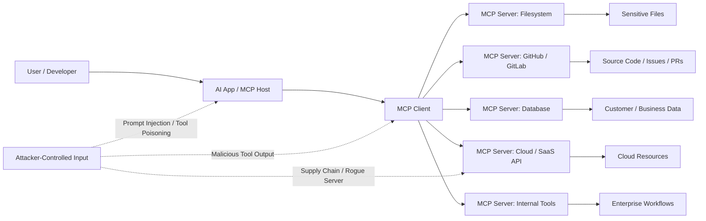

# Project Overview

## MCP Security Testing Guide (MCPSTG)

**Version:** 1.0 (draft)  
**Status:** Community guidance — not an official OWASP project document  
**License:** [GPL-3.0](LICENSE)  
**Structure:** Modeled on the [OWASP Web Security Testing Guide](https://owasp.org/www-project-web-security-testing-guide/) chapter layout, adapted for Model Context Protocol (MCP) systems.

## About this guide

MCPSTG is vendor-neutral security testing guidance for **hosts**, **clients**, **MCP servers**, **tools**, **resources**, **prompts**, **transports**, **gateways**, and **agentic workflows** built on MCP.

## How to read this guide

Read the files in this order. Chapter 3 holds the threat write-ups and the security tests in sections 3.1–3.19. Supply chain is [section 3.13](<03. MCP Threats and Attack Patterns/3.13-supply-chain.md>). Detection and SOC content is [section 3.12](<03. MCP Threats and Attack Patterns/3.12-logging-detection.md#detection-monitoring-and-soc-content>).

1. [Project Overview](<01. Project_Overview.md>) (this page)
2. [MCP Fundamentals](<02. MCP Fundamentals.md>)
3. [MCP Threats and Attack Patterns](<03. MCP Threats and Attack Patterns/3. MCP Threats and Attack Patterns.md>)
4. [Secure MCP Development](<04. Secure MCP Development.md>)
5. [MCP Security Taxonomy](<05. MCP Security Taxonomy.md>)
6. [Hacks, News, and Public Incidents](<06. Hacks, News, and Public Incidents.md>)
7. [Appendix A — Glossary](<07. Appendix A - Glossary.md>)
8. [Appendix B — Suggested Reading](<08. Appendix B - Suggested Reading.md>)
9. [Appendix C — Security Review](<09. Appendix C - Security Review.md>)
10. [Appendix D — Safe Lab Fixtures](<10. Appendix D - Safe Lab Fixtures.md>)
11. [Appendix F — Testing Tools](<11. Appendix F - Testing Tools.md>)

Host and client review rows sit in [Chapter 3](<03. MCP Threats and Attack Patterns/3. MCP Threats and Attack Patterns.md#host-and-client-baseline>), with server, gateway, inventory, access-control, and SOC rows. Incident response rows sit in [section 3.12](<03. MCP Threats and Attack Patterns/3.12-logging-detection.md#during-an-incident>). [Appendix C](<09. Appendix C - Security Review.md>) holds the status values, review flow, scorecard, and copy-paste review template.

[Contributing](CONTRIBUTING.md) explains how to edit the test sections. Report a result with the [finding template](<03. MCP Threats and Attack Patterns/test-case-format.md#mcp-red-team-finding-template>) and [Appendix C](<09. Appendix C - Security Review.md#mcp-security-review-template>).

## Important notice

This guide is **educational material**. Do not use it against systems without **explicit written authorization**. Use synthetic lab environments and placeholders—not production data or third-party targets without engagement.

---

The Model Context Protocol, or MCP, is an open protocol that allows LLM applications to connect with external data sources, tools, prompts, workflows, and services in a standardized way. MCP servers can expose **resources**, **prompts**, and **tools**, while MCP clients and hosts may interact with filesystem boundaries, user approvals, model sampling, and external execution flows. ([Model Context Protocol][1])

This repository treats MCP as a **new security boundary**.

MCP is where AI systems stop being “chat interfaces” and start becoming systems that can read files, call APIs, query databases, execute functions, trigger workflows, interact with enterprise tools, and make decisions that affect real environments. That means MCP security is not only about protecting prompts. It is about protecting the entire chain between the user, the model, the MCP client, the MCP server, the connected tool, and the target system.

The official MCP specification explicitly warns that MCP enables powerful capabilities through arbitrary data access and code execution paths, and that implementers must carefully address security and trust considerations. ([Model Context Protocol][1])



At a simple level:

```text
User
  |
  v
AI Application / MCP Host
  |
  v
MCP Client  <---- trust boundary ---->  MCP Server
                                      |
                                      v
                         Files / APIs / DBs / SaaS / Code / Cloud
```

The purpose of this project is to help the community understand, test, monitor, and secure this new layer before MCP becomes another invisible piece of enterprise infrastructure.

---

## What This Repository Covers

This repository is a curated, living collection of MCP security knowledge, research, tools, labs, and real-world references.

It covers both **offensive and defensive** aspects of MCP security, including publicly known vulnerabilities, advisories, proof-of-concepts, vulnerable environments, defensive patterns, detection ideas, secure design guidance, and governance material.

The repository will include:

| Category                              | What It Covers                                                                                                                                                                                        |
| ------------------------------------- | ----------------------------------------------------------------------------------------------------------------------------------------------------------------------------------------------------- |
| **MCP CVEs and Advisories**           | Publicly disclosed MCP-related CVEs, security advisories, severity, CVSS scores, EPSS where available, affected packages, exploit references, patches, and remediation guidance.                      |
| **Known MCP Security Issues**         | Non-CVE issues such as unsafe defaults, weak authorization, insecure local server execution, excessive tool permissions, context leakage, prompt injection chains, and tool description manipulation. |
| **Vulnerable MCP Labs**               | Intentionally vulnerable MCP servers, MCP goats, demo environments, CTF-style labs, training apps, and hands-on exercises for students, developers, red teams, and AppSec teams.                      |
| **Security Tools**                    | MCP scanners, tool-poisoning detectors, dependency scanners, policy engines, runtime monitors, gateway/proxy tools, logging utilities, and CI/CD checks.                                              |
| **Whitepapers and Research**          | Industry whitepapers, academic papers, threat models, architecture reviews, and research on MCP, agentic AI, tool use, prompt injection, and context security.                                        |
| **Conference Talks and Videos**       | YouTube videos, webinars, conference talks, podcasts, demos, workshops, and educational explainers related to MCP security.                                                                           |
| **Public Incidents and Case Studies** | Publicly discussed incidents, exploit writeups, attack simulations, vulnerable implementations, security disclosures, and lessons learned from MCP or MCP-like agentic systems.                       |
| **Defensive Guidance**                | Secure MCP design patterns, least privilege models, approval workflows, sandboxing, logging, monitoring, identity controls, secrets management, and governance checklists.                            |
| **Taxonomies and Frameworks**         | Mappings to OWASP MCP Top 10, OWASP LLM Top 10, MITRE ATLAS, AppSec controls, supply chain security controls, and enterprise AI governance models.                                                    |

The OWASP MCP Top 10 highlights risks such as token mismanagement, privilege escalation, tool poisoning, software supply chain attacks, command injection, insufficient authorization, lack of telemetry, shadow MCP servers, and context over-sharing. ([OWASP Foundation][2])

This repository should help answer questions like:

* What are the known security risks in MCP?
* Which MCP servers, SDKs, tools, and integrations have had public vulnerabilities?
* What vulnerable labs can be used for training?
* What tools can detect MCP misconfigurations or malicious tool behavior?
* How should developers build MCP servers securely?
* How should AppSec, SOC, and red teams review MCP-enabled systems?
* What should CISOs know before approving MCP adoption?

---

## Who This Is For

This project is designed for anyone building, breaking, defending, reviewing, or governing MCP-enabled systems.

### Developers Building MCP Servers

Developers can use this repository to understand secure MCP implementation patterns, common mistakes, unsafe defaults, authentication and authorization concerns, and tool execution risks.

MCP servers often sit between AI applications and sensitive systems. A small implementation mistake can expose files, credentials, APIs, databases, or business workflows. Developers should understand that every MCP tool is effectively an execution path that needs input validation, output validation, least privilege, logging, and clear user consent.

### AppSec and Product Security Teams

AppSec teams can use this repository as a review guide for MCP architecture, threat modeling, code review, secure design reviews, and CI/CD security checks.

For AppSec teams, MCP introduces familiar risks in a new package: injection, SSRF, secrets exposure, command execution, insecure authorization, dependency tampering, and over-permissioned integrations. The difference is that these risks may now be triggered through natural language, prompt injection, tool descriptions, poisoned context, or malicious tool responses.

### Red Teamers and AI Security Testers

Red teamers can use this repository to find vulnerable labs, attack techniques, exploit patterns, and test cases for MCP-enabled environments.

Useful testing areas include prompt injection through tool outputs, malicious MCP server registration, tool poisoning, excessive permissions, unauthorized file access, command injection, token theft, shadow MCP servers, cross-server data flows, and unsafe approval flows.

### SOC, Detection, and Incident Response Teams

SOC teams can use this repository to understand what MCP abuse looks like in logs and telemetry.

MCP activity may produce signals such as unusual tool invocation patterns, new or unknown MCP servers, sensitive file reads, unexpected API calls, abnormal database queries, suspicious command execution, repeated failed authorization attempts, or tool responses containing instruction-like text. OWASP’s MCP Security Cheat Sheet recommends logging MCP tool invocations with parameters, user context, and timestamps, and feeding those logs into SIEM systems for anomaly detection. ([OWASP Cheat Sheet Series][3])

### CISOs, Security Leaders, and Governance Teams

CISOs and governance teams can use this repository to understand MCP as an enterprise risk area.

MCP adoption can quickly spread through developer tools, AI IDEs, internal automation, SaaS integrations, and productivity workflows. Without governance, organizations may end up with shadow MCP servers, unmanaged tool permissions, unreviewed third-party servers, unclear data flows, and weak auditability.

This repository can support governance conversations around:

* Approved MCP server inventory
* Secure installation and review process
* Tool permission models
* Human approval requirements
* Logging and monitoring expectations
* Third-party MCP risk review
* Developer laptop and local server security
* Incident response for AI tool misuse
* Secure-by-default MCP development standards

---

## Why MCP Security Matters

MCP security matters because MCP gives AI applications access to things that matter.

A traditional chatbot might generate text. An MCP-enabled AI application can read files, call APIs, query databases, interact with code repositories, trigger workflows, and execute tools. That changes the risk model completely.

The official MCP security guidance discusses attack categories such as confused deputy risks, token passthrough, SSRF, session hijacking, local MCP server compromise, and scope minimization. ([Model Context Protocol][4])

In simple terms:

```text
Without MCP:
Prompt goes in -> Text comes out

With MCP:
Prompt goes in -> Model reasons -> Tool is selected -> Action is executed -> Data moves
```

That means an MCP security failure can become a real-world security incident.

### Key Risk Areas

#### Data Leakage

MCP servers may expose files, documents, repositories, databases, tickets, logs, cloud assets, or internal APIs. If permissions are too broad, if context is over-shared, or if tool outputs are not handled safely, sensitive data may leak into prompts, logs, model context, or unauthorized destinations.

#### Unauthorized Actions

If an MCP tool can send emails, modify tickets, create cloud resources, update code, run commands, or access business systems, then weak authorization can lead to unauthorized actions. The risk is not only “what the model says,” but “what the connected tool does.”

#### Prompt Injection Chains

Prompt injection becomes more dangerous when the model has access to tools. A malicious webpage, document, issue comment, email, log entry, or tool response may contain instructions that influence the model to call tools incorrectly, leak data, or bypass intended workflows. OWASP guidance recommends treating tool responses as untrusted input and explicitly instructing models that tool return values are data, not instructions. ([OWASP Cheat Sheet Series][3])

#### Tool Poisoning

MCP tools are often described to the model using natural language metadata. If a tool description is malicious, misleading, or modified after approval, the model may be tricked into using the tool in unsafe ways. The MCP specification itself notes that tool behavior descriptions should be treated as untrusted unless obtained from a trusted server. ([Model Context Protocol][1])

#### Supply Chain Compromise

MCP servers may be installed from public repositories, package managers, internal registries, or community examples. A malicious or compromised MCP server can become a bridge into developer machines, source code, credentials, internal APIs, or enterprise workflows. OWASP recommends installing MCP servers only from trusted sources, reviewing source code and tool definitions, verifying package integrity, scanning dependencies, and monitoring for tool definition changes. ([OWASP Cheat Sheet Series][3])

#### Shadow MCP Servers

As developers adopt AI IDEs and agentic tools, organizations may discover MCP servers running locally or inside workflows without central review. These shadow servers can create blind spots around data access, logging, approval flows, and third-party risk.

#### Weak Monitoring and Auditability

If MCP tool calls are not logged, security teams may not know which model called which tool, with what parameters, under which user identity, and what data was returned. This makes incident response, compliance, and forensic investigation much harder.

---

## Security Principle for This Project

The core security idea behind this repository is simple:

> **Treat every MCP server as a security boundary, every tool as a privileged action, every tool description as untrusted input, and every model-mediated action as something that must be logged, authorized, and reviewable.**

A secure MCP ecosystem should include:

* Least privilege for every MCP server and tool
* Clear user consent before sensitive tool calls
* Strong authentication and authorization
* Sandboxed local execution
* Secrets protection
* Tool input and output validation
* Trusted server installation and package verification
* Monitoring for tool changes and suspicious usage
* Centralized logging and audit trails
* Human approval for destructive or sensitive actions
* Incident response playbooks for MCP abuse

In short:

```text
MCP turns AI from "assistant" into "operator."

That is powerful.
That is useful.
That is risky.

And that is why MCP security matters.
```

[1]: https://modelcontextprotocol.io/specification/2025-11-25 "Specification - Model Context Protocol"
[2]: https://owasp.org/www-project-mcp-top-10/ "OWASP MCP Top 10 | OWASP Foundation"
[3]: https://cheatsheetseries.owasp.org/cheatsheets/MCP_Security_Cheat_Sheet.html "MCP Security - OWASP Cheat Sheet Series"
[4]: https://modelcontextprotocol.io/docs/tutorials/security/security_best_practices "Security Best Practices - Model Context Protocol"