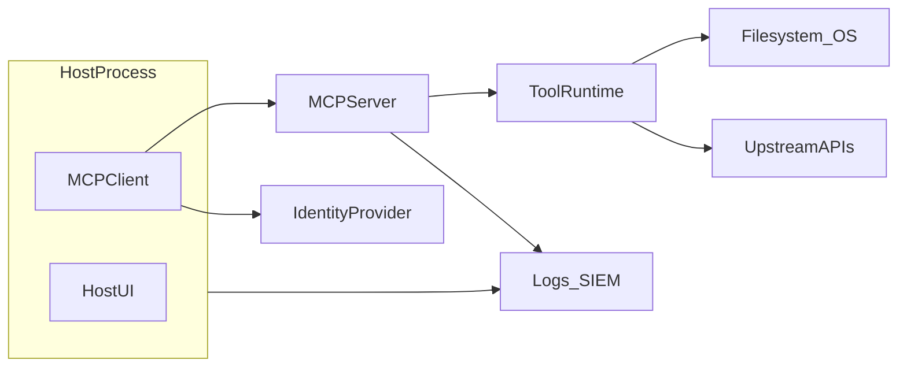
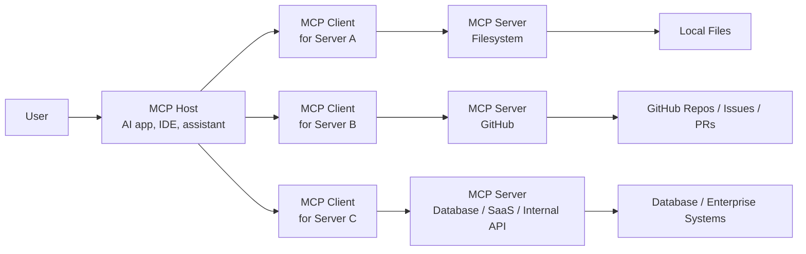
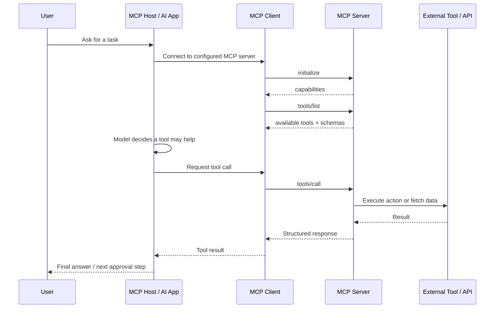
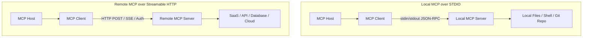

# MCP Fundamentals

Before jumping into attacks, CVEs, vulnerable labs, tool poisoning, or agentic abuse, it is important to understand what MCP actually is.

MCP, or **Model Context Protocol**, is an open-source standard for connecting AI applications to external systems such as files, databases, APIs, tools, workflows, and enterprise services. The official MCP documentation describes it as a standardized way for AI applications like Claude or ChatGPT to connect to data sources, tools, and workflows — often compared to a “USB-C port for AI applications.” ([Model Context Protocol](https://modelcontextprotocol.io/docs/getting-started/intro))

From a security perspective, MCP is important because it creates a new boundary: the place where an AI system stops “just chatting” and starts reading files, calling APIs, querying databases, sending messages, opening tickets, creating calendar events, or executing actions.

In simple words:

```text
Without MCP:
AI app + every external tool = custom integration chaos

With MCP:
AI app <-> MCP client <-> MCP server <-> external tool / data / API
```

MCP does not define how the AI model thinks, reasons, plans, or decides what to do. The official architecture docs are clear that MCP focuses on the protocol for context exchange and does not dictate how AI applications use LLMs or manage the context they receive. ([Model Context Protocol](https://modelcontextprotocol.io/docs/learn/architecture))

That distinction matters for security. MCP is not “the agent.” MCP is the connection layer that an agent, assistant, IDE, chatbot, or workflow engine may use to access external capabilities.

---


## What Is MCP?

**Model Context Protocol is a standard protocol that allows AI applications to connect with external tools, data sources, APIs, and systems in a structured way.**

Think of MCP as a common language between AI applications and the outside world.

An AI application may need to:

- read files from a local project,
- query a database,
- search documentation,
- open a GitHub issue,
- send a Slack message,
- check a calendar,
- call an internal API,
- retrieve cloud logs,
- or execute a workflow.

Without a standard like MCP, each AI application would need a custom connector for every tool. MCP reduces this integration mess by giving developers a consistent client-server protocol for exposing tools, resources, and prompts to AI applications. It also separates “how the model talks to integrations” from any single vendor’s plugin format, which is what makes those integrations portable across hosts. Anthropic introduced MCP as an open standard to replace fragmented integrations with a single protocol for connecting AI systems with data sources. ([Anthropic](https://www.anthropic.com/news/model-context-protocol))

A simple mental model:

```text
MCP is not the brain.
MCP is not the agent.
MCP is not the tool itself.

MCP is the structured bridge between AI applications and the systems they want to use.
```


### Beginner-friendly analogy

If an AI assistant is a very smart intern, MCP is the controlled office access card.

The intern may be smart, but without access, it cannot enter rooms, read documents, or perform work. MCP gives the AI application access to those rooms — but that also means access control, logging, approvals, and least privilege suddenly matter a lot.

### Security takeaway

MCP turns AI from a text generator into a system that can interact with real tools and real data. That makes MCP a security boundary, not just a developer convenience.

---

## Why MCP changes the security boundary

Traditional web and API testing often assumes a clear perimeter: a browser or mobile app calls an HTTP API with relatively stable entry points. An MCP deployment is a **chain of trust**. The host decides which servers to run, the client negotiates capabilities, the server routes model-driven requests to tools and data access paths, and upstream systems enforce their own policies.

MCP adds three things that move that perimeter:

- **Model-mediated control flow**, where natural language and partial context influence which tools run and with what arguments.
- **Tight coupling between data retrieval and action**, where the same channel can read a resource and trigger side effects through tools.
- **Distributed ownership**: the host, MCP server, tool runtimes, identity providers, gateways, and third-party APIs can be maintained by different teams with different threat models.

The security boundary is no longer only “HTTP ingress to a service.” It includes **local process boundaries**, **stdio or local sockets**, **remote transports**, **tool sandboxes**, **credential stores on the host**, and **human-in-the-loop approvals**. Each of those can fail on its own.

### Threat model primitives

When modeling threats, name these components and the trust lines between them. “The model did it” is not a control. The accountable control points are host policy, server checks, gateway rules, and identity-provider scopes.



---

## Why MCP security testing differs from traditional web/API testing

| Traditional web/API focus | MCP-specific additions |
|---------------------------|-------------------------|
| Parameter tampering on REST paths | Tool **schema** and **JSON-RPC** argument manipulation; dynamic tool lists |
| SSRF to internal URLs | Tool-mediated **egress** and gateway allowlists |
| Session cookies | Host-stored tokens, OAuth refresh, per-tool credentials |
| XSS in HTML | Unsafe rendering of tool outputs in host UIs; prompt and resource-driven injection |
| RBAC on APIs | **Model-routed** authorization: approval dialogs, tool chaining, planner loops |

Testing has to combine **protocol review**, **local configuration review**, **runtime abuse cases**, and **agentic workflow** analysis.

---

## Who this guide is for

- **Developers** integrating MCP servers and tools.
- **MCP server maintainers** responsible for tool safety and supply chain.
- **Security testers and red teams** assessing MCP deployments.
- **AppSec and AI security reviewers** designing controls and gates.
- **Platform engineers** operating hosts, gateways, and fleet policy.

## Scope

This guide covers security testing for:

- MCP **clients** and **hosts** (configuration, consent, rendering, logging).
- MCP **servers** (tool/resource handlers, authn/authz, transport exposure).
- **Tools**, **resources**, **prompts**, and related capability metadata.
- **Transports** (for example stdio, streamable HTTP) and channel security.
- **Registries**, packaging, and **supply chain** provenance.
- **Gateways** and enterprise policy enforcement.
- **Authorization**, **secrets**, **context** handling, and **agentic workflows**.
- **Logging**, **monitoring**, and detection validation.

### Out of scope

- Legal advice, contractual interpretation, or regulatory attestation language (point to your compliance function).
- Model training security, fine-tuning data leakage, or GPU infrastructure—except where MCP context flows intersect (for example RAG resources).
- Denial-of-service against unrelated third parties; any destructive testing outside an authorized lab.

## Safe testing rules and authorization requirements

1. **Written authorization** for every target environment (including internal staging). Verbal permission is not enough for formal assessments.
2. **Lab-first**: use synthetic workspaces, synthetic tools, and synthetic resources. Do not use customer production data as “test fixtures.”
3. **Non-destructive defaults**: prefer read-only probes, capped loops, and conservative rate limits. Escalate only with explicit approval.
4. **Data handling**: if you accidentally exfiltrate or log sensitive data during a test, follow your organization’s incident process; treat it as a real event.
5. **Rollback and recovery**: document how to restore configuration and revoke tokens after tests.
6. **Third parties**: do not aim abuse cases at vendors, registries, or shared SaaS without their engagement.
7. **Human safety**: tests involving approvals, elicitation, or user-visible actions must avoid misleading or harmful content.

---

## MCP vs Agents vs Tool Calling

MCP, agents, and tool calling are related, but they are not the same thing.

A useful way to remember it:

```text
MCP        = the protocol / integration layer
Agent      = the workflow or decision-making system
Tool call  = one specific action request
Tool       = the function or capability being invoked
```


### Comparison table


| Concept          | What it means                                                                   | Who controls it                                      | Example                                              | Security concern                                            |
| ---------------- | ------------------------------------------------------------------------------- | ---------------------------------------------------- | ---------------------------------------------------- | ----------------------------------------------------------- |
| **MCP**          | A protocol that connects AI applications to external tools, data, and workflows | Application / platform / server implementer          | Claude Desktop connecting to a filesystem MCP server | Over-permissioned servers, weak auth, unsafe transports     |
| **Agent**        | A system that plans, reasons, and takes multi-step actions                      | Agent framework / application logic / model behavior | “Plan my trip, book hotel, email itinerary”          | Autonomous action, tool chaining, goal hijacking            |
| **Tool calling** | A model or app invoking a specific function                                     | Model + host application                             | `send_email(to, subject, body)`                      | Unsafe arguments, lack of approval, command injection       |
| **MCP server**   | A server that exposes tools, resources, and prompts                             | MCP server developer/operator                        | GitHub MCP server, filesystem MCP server             | Sensitive data exposure, malicious tools, supply chain risk |
| **MCP client**   | Protocol component inside the host that connects to a server                    | Host application                                     | Client connection inside IDE or desktop assistant    | Trust decisions, permission prompts, session handling       |


### MCP vs agent

An **agent** is usually a larger workflow. It may decide what steps to take, which tools to use, when to retry, and how to complete a task.

MCP is the protocol that may give that agent access to tools and context.

```text
Agent: “I need to check the repo, create a branch, edit code, and open a PR.”

MCP: “Here is the standardized way to access GitHub, files, issues, and repo data.”
```


### MCP vs tool calling

Generic tool calling is usually model-provider-specific or application-specific. For example, one app may define a `search_web()` function, while another defines a `query_database()` function differently.

MCP standardizes how tools, resources, and prompts are exposed and discovered across compatible clients and servers. MCP servers can expose tools, resources, and prompts; the Python SDK documentation describes tools as action-like capabilities, resources as data/context, and prompts as reusable interaction templates. ([GitHub](https://github.com/modelcontextprotocol/python-sdk))

### Security takeaway

Do not secure “the agent” only. You also need to secure the protocol layer, server permissions, tool definitions, transport, authentication, and what context is passed back into the model.

---


## MCP Architecture

MCP follows a **client-server architecture**. An MCP host is the AI application users interact with. The host creates one or more MCP clients, and each MCP client maintains a dedicated connection to an MCP server. The MCP server provides context, tools, resources, or prompts to the host through the client. ([Model Context Protocol](https://modelcontextprotocol.io/docs/learn/architecture))

### Core participants


| Component           | Simple explanation                                                     | Example                                                         |
| ------------------- | ---------------------------------------------------------------------- | --------------------------------------------------------------- |
| **MCP Host**        | The AI application that the user interacts with                        | Claude Desktop, Claude Code, VS Code, Cursor, ChatGPT, AI IDEs  |
| **MCP Client**      | The protocol component inside the host that connects to one MCP server | A client session connecting VS Code to a Sentry MCP server      |
| **MCP Server**      | A program that exposes tools, resources, and prompts                   | Filesystem server, GitHub server, Slack server, database server |
| **External System** | The real system being accessed through the MCP server                  | Local files, GitHub, Postgres, Slack, Jira, cloud APIs          |
| **User**            | The human who asks the AI to do something                              | Developer, analyst, security engineer, business user            |


### High-level architecture




### MCP layers

MCP has two major layers:


| Layer               | What it does                                                                                                                     | Security relevance                                                                   |
| ------------------- | -------------------------------------------------------------------------------------------------------------------------------- | ------------------------------------------------------------------------------------ |
| **Data layer**      | Defines JSON-RPC based communication, lifecycle management, tools, resources, prompts, notifications, and capability negotiation | Controls what can be discovered, invoked, retrieved, or updated                      |
| **Transport layer** | Defines how messages move between client and server, including stdio and HTTP-based communication                                | Controls network exposure, authentication, message framing, and secure communication |


The official MCP architecture describes the data layer as JSON-RPC based and the transport layer as responsible for communication channels, connection establishment, message framing, and authorization. ([Model Context Protocol](https://modelcontextprotocol.io/docs/learn/architecture))

### Typical MCP flow




### Security takeaway

The dangerous part is not only “the model said something wrong.” The dangerous part is when the host routes model-driven decisions into real tools through MCP clients and servers.

---


## MCP Clients and Hosts

An **MCP host** is the user-facing AI application. It manages the overall experience, displays tool permissions, handles user approvals, and coordinates one or more MCP clients.

An **MCP client** is the protocol-level component created by the host to communicate with a particular MCP server. The official client documentation explains that the host is the application users interact with, while each client handles one direct communication channel with one server. ([Model Context Protocol](https://modelcontextprotocol.io/docs/learn/client-concepts))

### Examples of MCP hosts

MCP hosts can include:

- AI desktop applications,
- AI coding assistants,
- IDEs,
- developer environments,
- AI chat applications,
- agent platforms,
- enterprise assistants,
- workflow automation systems.

The official MCP intro lists broad ecosystem support across AI assistants and developer tools, including Claude, ChatGPT, Visual Studio Code, Cursor, MCPJam, and others. ([Model Context Protocol](https://modelcontextprotocol.io/docs/getting-started/intro))

### Host vs client distinction

```text
Host:
The full AI application the user sees.

Client:
The internal protocol connection from that host to one MCP server.
```

Example:

```text
Visual Studio Code = MCP Host

VS Code -> Sentry MCP Server      = MCP Client connection 1
VS Code -> Filesystem MCP Server  = MCP Client connection 2
VS Code -> GitHub MCP Server      = MCP Client connection 3
```


### What hosts usually manage

A good MCP host should manage:

- server configuration,
- user approval flows,
- tool visibility,
- permissions,
- authentication prompts,
- session state,
- logging,
- tool result display,
- user confirmation for sensitive actions.


### Multi-tenant hosts

Shared developer machines, jump hosts, and pooled agents are a separate trust problem from a single-user desktop. Session isolation and credential separation have to hold between users who share the host. Test those boundaries with `MCPSTG-AUTHZ-03`, `MCPSTG-CTX-04`, and `MCPSTG-PRVC-*`.

### Security takeaway

The host is where many trust decisions happen. A weak host can make a safe MCP server dangerous by auto-approving tools, hiding tool details, over-sharing context, or failing to show users what is about to happen.

---


## MCP Servers

An **MCP server** is a program that exposes capabilities to AI applications through the MCP protocol.

The official MCP server documentation describes servers as programs that expose specific capabilities to AI applications through standardized protocol interfaces, with common examples including filesystem servers, database servers, GitHub servers, Slack servers, and calendar servers. ([Model Context Protocol](https://modelcontextprotocol.io/docs/learn/server-concepts))

### Common MCP server categories


| Server type                    | What it exposes                    | Example capabilities                                   |
| ------------------------------ | ---------------------------------- | ------------------------------------------------------ |
| **Filesystem server**          | Local files and directories        | Read files, write files, search folders, move files    |
| **GitHub / Git server**        | Repositories, issues, PRs, commits | Create issues, review code, open PRs                   |
| **Slack / Teams server**       | Team messages and channels         | Read messages, summarize channels, send replies        |
| **Database server**            | SQL or NoSQL databases             | Query tables, inspect schema, generate reports         |
| **Cloud server**               | AWS, Azure, GCP, logs, resources   | Fetch logs, inspect configs, automate cloud workflows  |
| **Calendar server**            | Calendar events and availability   | Read schedule, create meetings, update events          |
| **Browser / Puppeteer server** | Browser automation                 | Open pages, scrape content, test workflows             |
| **Terminal / shell server**    | Command execution                  | Run scripts, install packages, inspect environment     |
| **Internal API server**        | Company-specific APIs              | Create tickets, query customer data, trigger workflows |


Anthropic’s launch announcement also referenced pre-built MCP servers for systems such as Google Drive, Slack, GitHub, Git, Postgres, and Puppeteer. ([Anthropic](https://www.anthropic.com/news/model-context-protocol))

### What MCP servers expose

MCP servers may expose:

- **Tools**: executable functions,
- **Resources**: readable context or data,
- **Prompts**: reusable templates or workflows.

A server may expose one capability or many. For example, a database MCP server may expose:

```text
Tools:
- run_sql_query
- explain_query_plan

Resources:
- database schema
- table metadata
- saved dashboards

Prompts:
- generate_monthly_report
- investigate_suspicious_transaction
```


### Security takeaway

An MCP server should be treated like an API server plus an automation bridge plus a potential privilege boundary. If it can read sensitive data or perform actions, it needs authentication, authorization, input validation, logging, rate limiting, and least privilege.

---


## MCP Tools, Resources, and Prompts

MCP servers expose three core building blocks:

```text
Tools     = actions the AI can invoke
Resources = data the AI/application can read
Prompts   = reusable instruction templates or workflows
```

The MCP architecture docs define tools as executable functions, resources as data sources, and prompts as reusable templates that help structure interactions with language models. ([Model Context Protocol](https://modelcontextprotocol.io/docs/learn/architecture))

### Tools

**Tools are executable actions.**

They allow an AI application to do something, not just know something.

Examples:

```text
create_issue()
send_slack_message()
query_database()
read_file()
write_file()
run_command()
book_meeting()
create_pull_request()
```

Tools are powerful because they can cause side effects. A tool may write to a database, send an email, modify files, or call an external API. The MCP server documentation explains that tools are schema-defined interfaces that LLMs can invoke, with JSON Schema used for validation, and that tools may require user consent before execution. ([Model Context Protocol](https://modelcontextprotocol.io/docs/learn/server-concepts))

#### Tool security risks

- Unsafe input passed into commands or APIs
- Excessive tool permissions
- Hidden or misleading tool descriptions
- Tool poisoning
- Prompt injection causing unsafe tool use
- Lack of user approval for sensitive actions
- Tool chaining that creates unexpected consequences

---


### Resources

**Resources are accessible data sources.**

They provide context to the AI application. Resources are often read-only, but they may expose highly sensitive information.

Examples:

```text
file:///project/secrets.md
github://repo/issues
calendar://events/2026
database://schema/customers
slack://channel/security-alerts
docs://internal/wiki/page
```

The MCP server docs describe resources as structured access to information from files, APIs, databases, or other sources, using unique URIs and MIME types. ([Model Context Protocol](https://modelcontextprotocol.io/docs/learn/server-concepts))

#### Resource security risks

- Sensitive data exposure
- Over-broad context sharing
- Reading secrets from local files
- Pulling confidential documents into model context
- Cross-user or cross-tenant data leakage
- Poisoned resources influencing model behavior

---


### Prompts

**Prompts are reusable templates or workflows.**

They help users invoke structured workflows consistently.

Examples:

```text
/security-review
/summarize-meeting
/generate-threat-model
/create-release-notes
/investigate-alert
/plan-vacation
```

The official server documentation describes prompts as reusable templates that are user-controlled and require explicit invocation, with methods such as `prompts/list` and `prompts/get`. ([Model Context Protocol](https://modelcontextprotocol.io/docs/learn/server-concepts))

#### Prompt security risks

- Prompt templates hiding unsafe instructions
- Prompt injection inside reusable workflows
- Prompts encouraging over-sharing of context
- Prompts invoking dangerous tools indirectly
- Confusing user-controlled prompts with trusted system instructions


### Simple summary


| Primitive     | Controlled by                         | Typical purpose    | Main risk                               |
| ------------- | ------------------------------------- | ------------------ | --------------------------------------- |
| **Tools**     | Often model-invoked, host-approved    | Perform actions    | Unauthorized or unsafe actions          |
| **Resources** | Application-selected or user-selected | Provide context    | Data leakage or context poisoning       |
| **Prompts**   | User-invoked                          | Reusable workflows | Hidden instructions or unsafe workflows |


### Capability drift

Tools and resources can **register or change at runtime**. A client can also keep a stale tool list, or the host and server can disagree on protocol version. Treat inventory and regression tests as part of reviewing these primitives (`MCPSTG-INFO-*`, `MCPSTG-SUPP-*`), including after the first setup.

### Security takeaway

For attackers, tools are actions, resources are intelligence, and prompts are influence. A secure MCP system must review all three.

---


## Local MCP vs Remote MCP

MCP servers can run locally or remotely.

A **local MCP server** usually runs on the same machine as the user or host application. A **remote MCP server** is hosted over a network or internet-accessible endpoint.

The official architecture docs explain that local MCP servers commonly use STDIO and typically serve a single MCP client, while remote MCP servers commonly use Streamable HTTP and may serve many MCP clients. ([Model Context Protocol](https://modelcontextprotocol.io/docs/learn/architecture))

### Local MCP

Local MCP servers often run on developer laptops or workstations.

Examples:

```text
Claude Desktop -> local filesystem server
AI IDE -> local Git server
Coding assistant -> local terminal server
Developer agent -> local repo analysis server
```

The official local MCP guide shows a filesystem server being configured for Claude Desktop, where the server can read, create, move, and search files with user approval. It also warns that the server runs with the user account’s permissions, so it can perform file operations the user can perform manually. ([Model Context Protocol](https://modelcontextprotocol.io/docs/develop/connect-local-servers))

#### Local MCP security risks

- Access to local secrets, SSH keys, cloud credentials, `.env` files
- Developer laptop becoming an AI-accessible control plane
- Local command execution
- Overly broad filesystem access
- Malicious MCP packages installed through package managers
- Weak approval UX leading users to approve risky actions
- Supply chain compromise through fake or lookalike servers


### Remote MCP

Remote MCP servers are hosted on the internet or inside enterprise infrastructure.

Examples:

```text
AI assistant -> remote Jira MCP server
Enterprise chatbot -> remote database MCP gateway
Security copilot -> remote SIEM MCP server
Developer tool -> remote GitHub MCP server
```

The official remote MCP guide explains that remote servers are internet-hosted, can integrate with project management systems, documentation systems, code repositories, and other API-enabled services, and commonly require authentication such as OAuth, API keys, or username/password combinations. ([Model Context Protocol](https://modelcontextprotocol.io/docs/develop/connect-remote-servers))

#### Remote MCP security risks

- Internet-exposed MCP endpoints
- Weak authentication
- Broken authorization between users or tenants
- Token theft
- OAuth misconfiguration
- SSRF-style access to internal systems. Treat tool-mediated HTTP as **egress** and test gateway allowlists (`MCPSTG-GW-*`), not only inbound MCP hardening
- Over-permissioned service accounts
- Missing rate limits
- Insufficient audit logs
- Abuse of remote tools at enterprise scale


### Local vs remote comparison


| Area              | Local MCP                                           | Remote MCP                                            |
| ----------------- | --------------------------------------------------- | ----------------------------------------------------- |
| Where it runs     | User machine / developer laptop                     | Network, cloud, SaaS, enterprise gateway              |
| Common transport  | STDIO                                               | Streamable HTTP                                       |
| Main strength     | Direct local access, low network overhead           | Shared access, easier deployment, centralized control |
| Main risk         | Local secrets, files, shell, workstation compromise | Auth, exposure, tenant isolation, API abuse           |
| Typical user      | Developer, power user, desktop assistant            | Enterprise teams, SaaS apps, platform integrations    |
| Security priority | Sandboxing and least filesystem access              | Strong auth, authorization, monitoring, rate limits   |


### Supply chain beyond package managers

Package managers are only part of the install path. Also review container base images, `npx`-style ephemeral installs, golden images, and whether signed provenance is required (`MCPSTG-SUPP-*`, `MCPSTG-GOV-*`). The same checks apply to local servers and to images that host remote servers.

### Security takeaway

Local MCP is dangerous because it is close to sensitive user files and credentials. Remote MCP is dangerous because it is exposed, scalable, and often connected to enterprise systems. Both need security controls, and the threat model is different for each.

---


## MCP Transports

MCP communication happens through transports.

The official MCP transport specification states that MCP uses JSON-RPC messages encoded as UTF-8 and defines two standard transport mechanisms: **stdio** and **Streamable HTTP**. ([Model Context Protocol](https://modelcontextprotocol.io/specification/2025-03-26/basic/transports))

### STDIO transport

STDIO uses standard input and output streams.

In this model:

```text
MCP client launches MCP server as a subprocess.
Client writes JSON-RPC messages to server stdin.
Server writes JSON-RPC messages to stdout.
```

The MCP transport specification states that, in stdio transport, the client launches the server as a subprocess, the server reads messages from stdin, sends messages to stdout, and must not write anything to stdout that is not a valid MCP message. ([Model Context Protocol](https://modelcontextprotocol.io/specification/2025-03-26/basic/transports))

#### STDIO security risks

- Unsafe subprocess execution
- Command/path injection in server launch configuration
- Malicious local server binaries or packages
- Secrets leaked through environment variables
- Logs accidentally exposing sensitive data
- Server running with full user permissions
- Confused trust between “local” and “safe”


### Streamable HTTP transport

Streamable HTTP uses HTTP-based communication.

The official architecture docs describe Streamable HTTP as using HTTP POST for client-to-server messages with optional Server-Sent Events for streaming. It enables remote server communication and supports standard HTTP authentication methods such as bearer tokens, API keys, custom headers, and OAuth-based authentication. ([Model Context Protocol](https://modelcontextprotocol.io/docs/learn/architecture))

#### HTTP security risks

- Weak authentication
- Missing TLS
- Token leakage
- Broken access control
- Cross-tenant data exposure
- SSRF and network pivoting
- Publicly exposed debug endpoints
- Missing request validation
- Replay or session abuse
- Insufficient monitoring


### Transport diagram




### Security takeaway

Transport is not just plumbing. Transport decides process boundaries, network exposure, authentication patterns, logging opportunities, and attack surface. A secure MCP server over an unsafe transport is still an unsafe deployment.

---


## Roots, sampling, and elicitation

These client capabilities let a server reach back toward the user’s files, the model, or the person. Roots, sampling, and logging are deprecated as of protocol version `2026-07-28` and are scheduled for removal, but hosts in the field still implement them. Review them when a client still advertises the capability. Host-side controls are in [3.4](<03. MCP Threats and Attack Patterns/3.04-authorization-permission.md#roots-are-not-an-access-control-decision>) for roots and in [3.8](<03. MCP Threats and Attack Patterns/3.08-context-memory.md#sampling-abuse>) for sampling and elicitation.

Prompts, forms, and sampling-style flows are **trust boundaries**. Exercise them with `MCPSTG-PRMT-*` and approval UX tests (`MCPSTG-AUTHZ-*`).

### Roots — filesystem trust boundary

Hosts can expose **roots** (workspace folders) to MCP servers so file-oriented tools know allowed directories. The MCP specification describes roots in the lifecycle and client capabilities (see **Roots** in the [MCP specification](https://modelcontextprotocol.io/specification/2025-11-25)).

**Security checks:**

1. Server must **canonicalize paths** and reject `..`, symlinks that escape roots, and alternate path encodings.
2. Changing roots mid-session should trigger **re-consent** if the host’s threat model requires it.
3. Log `roots/list` changes for forensic reconstruction after suspected path-escape incidents.

### Sampling — server-initiated model calls

**Sampling** lets an MCP server ask the host to run a model completion (subject to host support and policy). That inverts the usual “user asks, model answers” flow: a **server** supplies prompt material. Risks include token/cost abuse, **prompt exfiltration** (crafting completions that leak prior context), and chaining with tools to refine stolen data.

**Control:** Default **deny** for third-party servers; allow only for audited internal servers; cap tokens and log full server identity plus the sampling request hash.

### Elicitation — server-driven user prompts

**Elicitation** is a structured way for servers to request information from the user through the host. From a security perspective, this is close to **HTML form phishing**: a malicious server could request passwords, OTPs, or approval to escalate scopes.

**Control:** Host UI must show **immutable server identity**, a **reason string**, and must **never** pre-fill secrets. Block elicitation from servers that are not on the enterprise allowlist.

---

## Remote MCP authorization (OAuth)

Remote MCP servers are expected to integrate with OAuth 2.x patterns described in the MCP project’s **Authorization** documentation. See the dated spec chapter [Authorization (2025-11-25)](https://modelcontextprotocol.io/specification/2025-11-25/basic/authorization), and use a newer specification date when the deployment under test pins one.

Exercise these alongside `MCPSTG-AUTHN-*`, `MCPSTG-SECR-*`, and `MCPSTG-TRNS-02`:

- Redirect URI allowlists
- Refresh token storage
- Audience and scope binding
- Silent consent widening

Supporting IETF documents:

| RFC | Title | Why it matters for MCP |
| --- | --- | --- |
| [RFC 9728](https://datatracker.ietf.org/doc/html/rfc9728) | OAuth 2.0 Protected Resource Metadata | Resource servers publish metadata; clients discover authorization servers. **Metadata poisoning** and TLS mistakes here are high impact. |
| [RFC 9700](https://datatracker.ietf.org/doc/html/rfc9700) | OAuth 2.0 Security BCP | Redirect URI rigor, PKCE for public clients, token rotation guidance. |
| [RFC 7591](https://datatracker.ietf.org/doc/html/rfc7591) | Dynamic Client Registration | Lowers friction for attackers registering malicious clients if authorization servers do not validate registrants. The MCP revision `2026-07-28` deprecates this flow; use Client ID Metadata Documents or pre-registration. |

---

## OpenTelemetry semantic conventions

The OpenTelemetry **Gen AI** semantic conventions define four MCP-specific span attributes: `mcp.method.name`, `mcp.protocol.version`, `mcp.resource.uri`, and `mcp.session.id`. Generic tool-call attributes, such as `gen_ai.tool.name`, are defined separately in the Gen AI conventions. This gives SOC teams vendor-neutral field names.

- **Documentation:** [Semantic conventions for Gen AI — MCP](https://opentelemetry.io/docs/specs/semconv/gen-ai/mcp/).

Example attribute names, which should be confirmed against the spec version you pin: `gen_ai.operation.name`, `mcp.session.id`, `gen_ai.tool.name`, `gen_ai.tool.type`.

---

## How to use this guide

1. Read [MCP Threats and Attack Patterns](<03. MCP Threats and Attack Patterns/3. MCP Threats and Attack Patterns.md>) for the threat write-ups and test catalog.
2. Use that chapter to pick categories and test IDs.
3. Execute tests from the matching section (3.1–3.19). Each test includes explanation and example snippets on the same page.
4. Document findings using the [red team finding template](<03. MCP Threats and Attack Patterns/test-case-format.md#mcp-red-team-finding-template>).

## References

- [OWASP Web Security Testing Guide](https://owasp.org/www-project-web-security-testing-guide/) (structure inspiration only).
- [OWASP Top 10 for LLM Applications](https://owasp.org/www-project-top-10-for-large-language-model-applications/).
- [OWASP API Security Top 10](https://owasp.org/API-Security/).
- [OWASP Application Security Verification Standard (ASVS)](https://owasp.org/www-project-application-security-verification-standard/).
- [Model Context Protocol specification](https://modelcontextprotocol.io/specification/2025-11-25) (cite the version under test).

---

MCP is best understood as the **connective tissue between AI applications and real-world systems**. It gives AI applications a standard way to discover tools, read resources, use prompts, and communicate with servers. That standardization is powerful, and it creates a new security boundary. Once an AI system can reach files, APIs, databases, calendars, terminals, browsers, and enterprise workflows, MCP security becomes AppSec, cloud security, identity security, supply chain security, and AI safety all meeting in one very busy hallway.

> MCP is the USB-C port for AI — useful, universal, and absolutely something you should not plug random devices into.