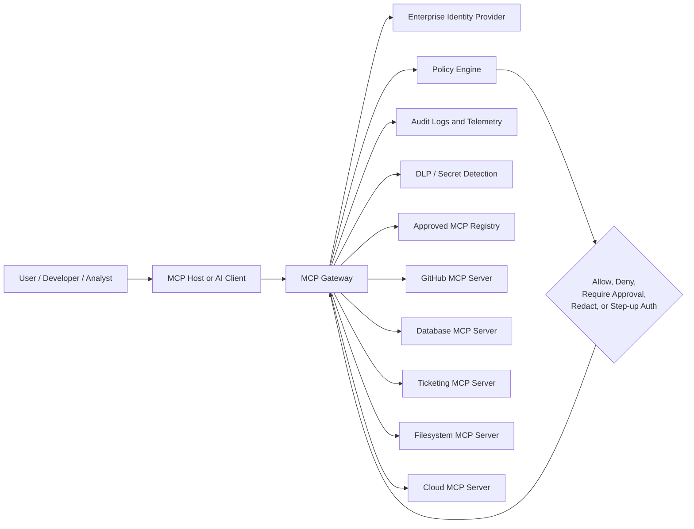
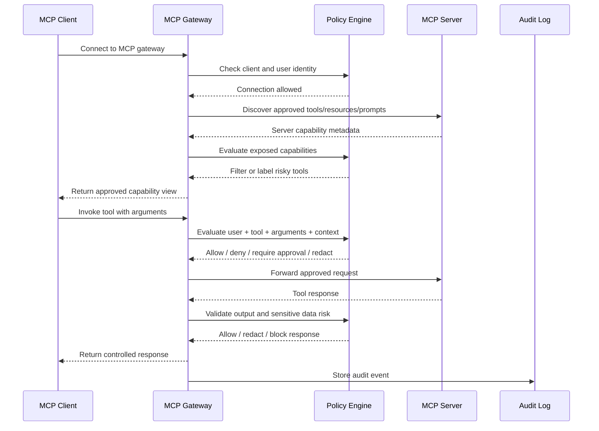

# 3.16 Gateway, Broker, and Egress Controls (`GW`)

[← Chapter 3 overview](<3. MCP Threats and Attack Patterns.md>) · [Test case format](test-case-format.md)

## Overview

Gateway tests validate **outbound control** for tool-mediated HTTP and other egress: allowlists, SSRF protections, and rate limiting at a central broker. Enterprise gateway architecture, policy decision points, and trust zones are in [MCP Gateway Architecture](#mcp-gateway-architecture).

## Why this category matters

Tools that fetch URLs are SSRF primitives. Without gateway policy, a model can pivot to metadata endpoints, internal admin panels, or cloud credential services.

## Scope

Upstream URL allowlists, DNS rebinding protections, header forwarding rules, throttling and abuse counters at the gateway.

## When to prioritize

Critical when any tool performs **network** calls; defense in depth alongside safe tool code.

## Related categories

[TOOL](3.05-tool-security.md), [INPV](3.10-input-validation.md), [GOV](3.14-enterprise-governance.md), [ABUS](3.18-resilience-abuse.md), [TRNS](3.15-transport-channel.md), [AUTHN](3.03-identity-authentication.md)

## Common test chains

GW-02 + TOOL (HTTP tools); GW-03 + ABUS-01.

## Threats and attack patterns

Gateway tests exist because several published MCP bugs are “the process fetched a URL the other side chose.” Some of those URLs are OAuth metadata. Some are tool or header inputs. Rate limiting is included because unbounded outbound calls are how the cost incidents in the API literature show up.

### OAuth discovery URLs as an SSRF channel

The MCP security best-practices document (28 July 2026) defines the client-side case. During OAuth metadata discovery the client fetches URLs that a malicious MCP server can set: `resource_metadata` from `WWW-Authenticate`, `authorization_servers` from the protected-resource metadata, and `token_endpoint`, `authorization_endpoint`, and related URLs from authorization-server metadata.

> “Server-Side Request Forgery (SSRF) is an attack where an attacker can induce an MCP client to make HTTP requests to unintended destinations, potentially accessing internal network resources, cloud metadata endpoints, or other protected services.”
>
> — [Security Best Practices](https://modelcontextprotocol.io/docs/2026-07-28/tutorials/security/security_best_practices), Server-Side Request Forgery

The document lists the destinations it is worried about: private addresses, the cloud metadata address `169.254.169.254`, loopback services, a name whose DNS answer changes between check and use, and redirects. Stated risks include cloud credential theft, topology disclosure through errors, and the client acting as a proxy through a firewall. Required direction: HTTPS in production, block private and link-local ranges (the document cites RFC 9728 section 7.7), apply the same checks to redirects, and consider an egress proxy. It also says authorization servers that fetch Client ID Metadata Documents have the same SSRF exposure, with the malicious client supplying the URL.

[GHSA-c9xm-49cp-xcr9](https://github.com/modelcontextprotocol/rust-sdk/security/advisories/GHSA-c9xm-49cp-xcr9) is that client bug in the official Rust SDK. The advisory says the `rmcp` OAuth client accepts a server-controlled `resource_metadata` URL from `WWW-Authenticate` and GETs it with no same-origin check and no block for loopback, link-local, or RFC 1918. The advisory’s impact is SSRF from any application that embeds that client, including cloud metadata and private services. It says a metadata document that matches the expected shape can chain into further authorization-server fetches.

**Tests:** `MCPSTG-GW-01`, `MCPSTG-GW-02`. An allowlist of upstream MCP hosts is not the same control as an allowlist of URLs the client will fetch during OAuth discovery.

### Tool and header SSRF on the server

[CVE-2026-27826](https://github.com/advisories/GHSA-7r34-79r5-rcc9), `mcp-atlassian` before 0.17.0, High, published 10 March 2026. An unauthenticated caller who can reach the HTTP endpoint sets `X-Atlassian-Jira-Url` or `X-Atlassian-Confluence-Url`. The advisory says middleware stores the header with no validation and the Jira client then requests `{that url}/rest/api/2/myself`. No `Authorization` header is required. The advisory says the flaw is invisible to tool-level review because it is not in a tool handler. Stated cloud impact: IAM credentials from the instance metadata service. Stated general impact: internal reconnaissance and attacker-controlled bytes in LLM tool results. Fixed in 0.17.0.

The project’s follow-up [GHSA-72fm-whvq-jghf](https://github.com/sooperset/mcp-atlassian/security/advisories/GHSA-72fm-whvq-jghf) says the 0.17.0 validator resolves DNS when it checks the URL and does not pin that address for the later HTTP connection, so a name can resolve to a public address at check time and a different address at connect time. Treat “we call `validate_url_for_ssrf`” as incomplete until the connection uses the address that was validated. The MCP security document says the same thing in its DNS TOCTOU paragraph.

**Tests:** `MCPSTG-GW-02`. Include header-supplied base URLs, tool arguments that are URLs, and redirect targets. The file-write bug [CVE-2026-27825](https://github.com/advisories/GHSA-xjgw-4wvw-rgm4) is a different issue; do not close it by fixing SSRF.

### Egress that carries stolen context

Willison’s lethal trifecta (16 June 2025) treats “any external communication” as the leg that turns a prompt injection into data theft, including an HTTP tool, an image URL, or a link the user is asked to click ([The lethal trifecta](https://simonwillison.net/2025/jun/16/the-lethal-trifecta/)). The GitHub MCP demonstration used a public pull request as that leg. The WhatsApp demonstration used `send_message`. A gateway allowlist that only permits the MCP server’s own host, and that does not see tool calls to other destinations, does not cover those legs. **Tests:** `MCPSTG-GW-01` for each tool that can choose a destination. Human approval of the destination is `MCPSTG-TOOL-06`.

### Unbounded outbound calls

OWASP API4:2023 says missing limits on how often a client can call an API, and missing spend limits on third parties such as SMS, produce denial of service or a direct bill ([Unrestricted Resource Consumption](https://owasp.org/API-Security/editions/2023/en/0xa4-unrestricted-resource-consumption/)). Their first scenario is a password-reset API that calls an SMS provider at a per-message price. Snyk’s `postmark-mcp` note is the MCP-shaped version of volume: agents may have sent large amounts of mail with no person in the loop ([Snyk](https://snyk.io/blog/malicious-mcp-server-on-npm-postmark-mcp-harvests-emails/)). This guide did not find a published MCP CVE whose CVSS impact was only “cloud bill.” **Tests:** `MCPSTG-GW-03`, with [3.18](3.18-resilience-abuse.md).

### Canonical attack patterns

The write-ups below moved here from the threats chapter. Each one names the abuse, a lab-safe example, the impact, red flags, and defensive checks. Published cases earlier in this section remain the sourced record. Use both when you choose tests.

### Server-Side Request Forgery

**Tests:** `MCPSTG-GW-02`, `MCPSTG-TRNS-02`.

SSRF in MCP shows up in two places that feel different and fail the same way. Something the attacker influenced becomes a URL, and a component with a better network position fetches it.

The first place is OAuth discovery. A malicious MCP server can put internal URLs into the metadata a client is supposed to fetch: the `resource_metadata` URL from a `WWW-Authenticate` header, an entry in `authorization_servers`, or a `token_endpoint` inside authorization-server metadata. The client then requests `http://169.254.169.254/`, a Redis port on localhost, or an admin API on a private address, and the response can leak back through an error string. An authorization server that fetches a Client ID Metadata Document from a URL the client supplied has the same job, with the roles reversed. ([Model Context Protocol](https://modelcontextprotocol.io/docs/2026-07-28/tutorials/security/security_best_practices))

The second place is an ordinary tool. A “fetch this page” or “call this webhook” parameter is passed to an HTTP client that follows redirects and believes DNS. The official servers repo has had public issues in this class, and an IETF draft on MCP security considerations uses them as the running example: block the literal metadata address, and a hostname that rebinds, or a 302 that points inward, still gets through. ([IETF](https://www.ietf.org/archive/id/draft-mohiuddin-mcp-security-considerations-00.html))

#### What the fetch has to survive

```text
Allowed public HTTPS URL                  -> fetch, with a size limit
Literal private, loopback, or link-local  -> refuse before connect
Name that resolves to a private address   -> refuse before connect
Public URL that redirects inward          -> refuse the hop
DNS answer that changes after the check   -> pin the address, or refuse
Odd IP spellings (octal, mapped IPv6)     -> same policy as the real address
Cloud metadata (169.254.169.254 and kin)  -> refuse
```

#### Impact

* Cloud credentials leave a metadata service through the MCP client or server.
* The MCP component becomes a proxy that bypasses a network ACL.
* A POST to a token endpoint, or to an internal admin route, changes state rather than only reading it.

#### Red flags

* Tools whose schema is essentially “URL in, body out.”
* HTTP clients created with default redirect behavior and no connect-time address check.
* OAuth metadata hosts that are not on an allowlist.
* Error messages that echo the response body from a failed discovery fetch.

#### Defensive guidance

* Require HTTPS for OAuth URLs in production. Keep plain HTTP for loopback development only.
* Decide the address at connect time, and connect to that address. A check followed by a second DNS lookup is a gap.
* Apply the same rules to every redirect hop, or disable redirects.
* Put server-side clients behind an egress proxy that already refuses internal ranges. Smokescreen-style proxies exist for this reason.
* Prefer a destination allowlist for tools. A blocklist of IP ranges is a backstop, not the design.

## MCP Gateway Architecture

An MCP gateway is an infrastructure layer that sits between MCP clients and MCP servers. Instead of every AI client connecting directly to every approved or unapproved MCP server, the client connects to a controlled gateway. The gateway then routes requests to approved backend MCP servers based on identity, policy, tool scope, data sensitivity, and runtime context.

In simple terms: **an MCP gateway is the enterprise front door for MCP traffic.**

It can centralize:

* Authentication
* Authorization
* Routing
* Tool allowlisting and denylisting
* Policy enforcement
* Approval workflows
* Rate limiting
* Secrets handling
* Logging and monitoring
* Data loss prevention checks
* Server isolation
* Version control
* Emergency kill switches

Without a gateway, every MCP client becomes its own mini-control plane. That creates configuration sprawl, inconsistent permissions, weak auditability, and “who approved this thing?” moments during incidents.

### Basic gateway pattern

```text
+-------------------+       +----------------------+       +-----------------------+
|                   |       |                      |       |                       |
|   MCP Client /    | ----> |     MCP Gateway      | ----> |   Approved MCP Server |
|   AI Host / IDE   |       |                      |       |   GitHub / DB / SaaS  |
|                   |       |  AuthN + AuthZ       |       |                       |
+-------------------+       |  Policy Enforcement |       +-----------------------+
                            |  Routing             |
                            |  Logging             |       +-----------------------+
                            |  DLP / Risk Scoring  | ----> |   Approved MCP Server |
                            |  Rate Limiting       |       |   Filesystem / Cloud  |
                            |  Approvals           |       +-----------------------+
                            |                      |
                            +----------------------+
```

### Gateway architecture using Mermaid



### What the gateway should enforce

A mature MCP gateway should not behave like a dumb reverse proxy. MCP traffic is not ordinary API traffic because the caller may be an AI agent acting on behalf of a user, a workflow, or another system. The gateway must understand enough about MCP usage to make security decisions at the level of **user + client + server + tool + action + data context**.

A strong gateway should enforce controls such as:

| Control Area       | What the Gateway Should Do                                                | Example                                                                          |
| ------------------ | ------------------------------------------------------------------------- | -------------------------------------------------------------------------------- |
| Authentication     | Verify the user, client, workload, or agent identity before access        | Only authenticated employees can use internal MCP servers                        |
| Authorization      | Check whether the identity can access a server, tool, resource, or action | Developers can read GitHub issues but cannot modify production deploy settings   |
| Tool Policy        | Allow, deny, or require approval for specific tools                       | `read_ticket` allowed, `delete_ticket` requires approval                         |
| Context Policy     | Evaluate what data is being sent to or returned from tools                | Block secrets, customer PII, or source code from being sent to untrusted servers |
| Routing            | Send traffic only to approved backend MCP servers                         | Route finance tools only through the finance-approved MCP server                 |
| Isolation          | Separate environments, tenants, teams, and trust zones                    | Sandbox experimental servers away from production resources                      |
| Monitoring         | Capture MCP calls, arguments, outputs, status, and decisions              | Log tool calls with user, client, server, tool, and policy outcome               |
| Rate Limiting      | Prevent runaway agents or abuse                                           | Stop an agent from calling `send_email` 500 times in 3 minutes                   |
| Change Control     | Detect server metadata and tool description changes                       | Alert when a tool description changes from read-only to write-capable behavior   |
| Emergency Response | Disable a server, tool, user, or client quickly                           | Kill switch for a compromised MCP server                                         |

### Gateway policy decision points

A gateway should make decisions at multiple stages, not only at connection time.



### Recommended gateway decision model

Every MCP request should be evaluated using a structured decision model:

```text
Decision = f(
  user_identity,
  client_identity,
  agent_identity,
  server_identity,
  tool_name,
  tool_version,
  requested_action,
  input_arguments,
  output_sensitivity,
  data_classification,
  environment,
  business_owner,
  risk_score,
  approval_state,
  session_context
)
```

This helps avoid overly broad decisions such as “Alice can use the GitHub MCP server.” A safer policy is: “Alice, from the approved coding client, can use read-only GitHub tools against repositories owned by her team, but write actions require approval and production branch changes are denied.”

### Gateway trust zones

Enterprise MCP deployments should define trust zones for servers and clients.

| Trust Zone             | Description                                                                                                     | Example Controls                                                      |
| ---------------------- | --------------------------------------------------------------------------------------------------------------- | --------------------------------------------------------------------- |
| Public / Untrusted     | Community servers, experimental tools, unknown maintainers                                                      | Sandbox only, no secrets, no write tools, no sensitive data           |
| Internal Development   | Internal servers used by engineering teams                                                                      | SSO, team RBAC, source code access rules, logging                     |
| Production Operations  | Servers that can affect production systems                                                                      | Step-up auth, approvals, break-glass access, strong audit             |
| Regulated Data         | Servers accessing customer data, financial data, health data, or legal records                                  | DLP, data minimization, purpose limitation, encryption, strict review |
| High-Impact Automation | Servers that can send emails, approve workflows, change infrastructure, deploy code, or modify identity systems | Human-in-the-loop, transaction limits, separation of duties           |

### Gateway security requirements

A production MCP gateway should support:

* **Strong identity integration** using enterprise SSO, workload identity, or service identity.
* **Per-tool authorization**, not only per-server authorization.
* **Per-action policy**, especially for write, delete, execute, deploy, transfer, or notify actions.
* **Capability filtering**, so clients only see tools they are allowed to use.
* **Tool risk labels**, such as read-only, write-capable, destructive, external-facing, sensitive-data, or privileged.
* **Argument inspection**, including file paths, URLs, repo names, command parameters, SQL queries, and ticket IDs.
* **Output inspection**, including secrets, credentials, tokens, PII, source code, internal URLs, and regulated data.
* **Session-aware authorization**, because an action may be safe in one context and unsafe in another.
* **Approval hooks**, where high-risk actions require user, manager, system owner, or security approval.
* **Immutable audit logs**, suitable for incident response, compliance, and forensic review.
* **Version and metadata tracking**, so changes to tool descriptions, schemas, dependencies, and permissions are visible.
* **Emergency disablement**, including disabling one tool without taking down an entire server.

### Common gateway anti-patterns

Avoid these patterns:

* **Gateway as a blind pass-through**: If the gateway cannot inspect tool names, arguments, outputs, or server metadata, it provides limited MCP security value.
* **Server-level allowlisting only**: Approving an entire server without reviewing individual tools can expose dangerous actions.
* **One policy for all users**: Developers, SOC analysts, finance users, and executives should not inherit the same tool access.
* **No output validation**: Tool responses can contain prompt injection, secrets, poisoned context, or untrusted instructions.
* **No change detection**: A once-safe server can become unsafe after an update, dependency change, or maintainer compromise.
* **No user-visible approvals**: Users should understand when an AI system is about to perform a sensitive action on their behalf.
* **Long-lived shared credentials**: Shared tokens make attribution, revocation, and least privilege difficult.

### Security outcome

A good gateway turns MCP from a collection of unmanaged point-to-point connections into a governed control plane. It gives organizations one place to enforce policy, one place to observe behavior, and one place to respond when something goes wrong.

### Gateway and policy review

Record each row as Pass, Partial, Fail, Accepted Risk, or N/A. Status values and evidence fields are in [Appendix C — Security Review](<../09. Appendix C - Security Review.md>).

| Check | What to verify | Why it matters | Evidence to collect | Good examples | Common gaps |
| --- | --- | --- | --- | --- | --- |
| Gateway need is assessed | Determine whether central brokering is needed. | Large organizations need consistent policy and visibility. | Architecture decision record. | Gateway used for sensitive tools and remote servers. | Every client connects directly to every server. |
| Gateway enforces identity | Gateway knows user, client, workspace, and server. | Policy needs context. | Auth design, token claims. | Policy uses user group and workspace trust. | Gateway only sees anonymous requests. |
| Gateway enforces authorization | Gateway can allow, deny, or require approval. | Central control reduces inconsistent client behavior. | Policy examples. | Block external-send tools for a low-privilege group. | Gateway is only a proxy with no policy. |
| Gateway logs decisions | Policy decisions must be auditable. | Helps SOC and compliance. | SIEM logs. | `decision=deny reason=external-destination`. | Only server-side logs exist. |
| Gateway supports emergency block | Security can rapidly block a server or tool. | Critical during incidents. | Admin runbook. | One-step block for a malicious server. | Must wait for every user to change config. |

Minimum acceptance criteria:

* High-risk MCP usage has centralized policy enforcement, logging, and emergency blocking.

---

## Enterprise gateway: concrete controls

### Kill switch

Maintain a gateway config flag `mcp_global_enabled: false` pushed in **< 60 seconds** from SOAR during active exploitation. Pair with client-side emergency disable via MDM for VS Code policy.

### Per-tenant routing

If the gateway multiplexes SaaS tenants, enforce:

- **JWT `aud` / `tid` claim** validation before routing `tools/call` to a backend MCP server instance.
- **Separate OAuth client IDs** per environment (dev/stage/prod).

Identity checks for that routing decision are in [3.3 Identity and Authentication](3.03-identity-authentication.md#enterprise-identity-at-the-gateway). Rate-limit starting points are in [3.18](3.18-resilience-abuse.md#rate-limit-starting-points). The audit fields for a gateway decision are in [3.12](3.12-logging-detection.md#recommended-mcp-event-schema).

## Test cases

Each test below is explained in this section with summary, scenario, step-by-step guidance, **example MCP code snippets**, expected results, and remediation. Use **View** to jump to a test.

| ID | Test case | Risk | Type | View |
|----|-----------|------|------|------|
| `MCPSTG-GW-01` | Test Gateway Allowlist Enforcement for Upstream Tool Destinations | Critical | Hybrid | [View](#mcpstg-gw-01) |
| `MCPSTG-GW-02` | Test SSRF Protections for Tool-Mediated HTTP Requests | Critical | Hybrid | [View](#mcpstg-gw-02) |
| `MCPSTG-GW-03` | Test Rate Limiting and Abuse Throttling at the Gateway | Medium | Hybrid | [View](#mcpstg-gw-03) |

### MCPSTG-GW-01 — Test Gateway Allowlist Enforcement for Upstream Tool Destinations

<a id="mcpstg-gw-01"></a>

#### Summary

Enterprise MCP **gateways** often sit between hosts and MCP servers or between servers and the open internet. A core control is an **allowlist** of upstream destinations that tools may reach (HTTP APIs, internal services, cloud control planes). Misconfigured gateways turn every tool into a generic egress client—amplifying SSRF, data exfiltration, and supply-chain callbacks.

#### Scenario

- **Architecture:** MCP server tools call HTTP endpoints; traffic is forced through `<AUTHORIZED_LAB_SERVER>` gateway policies.
- **Attacker position:** Prompt or resource content steers the model to call `https://evil-lab.example` (use only a **non-routable** or **lab-owned** hostname in scope) or an internal service hostname.
- **Potential impact:** Data exfiltration, port scanning via timing, or webhook abuse.

#### Test Objectives

- Verify **default deny** for unknown destinations at the gateway.
- Verify allowlist changes are **versioned**, **audited**, and **tested** in CI where possible.
- Verify denied attempts are visible in **SIEM** with enough context to tune rules.

#### Preconditions

- Lab gateway policy package and a safe external endpoint you control.
- A tool that accepts a URL or host parameter (`<TEST_TOOL_NAME>_http_fetch` pattern).

#### How to Test

##### 1. Manual Review

Map every tool that can perform network I/O. Classify destinations (SaaS APIs, internal microservices, object stores).

##### 2. Configuration Review

Read allowlist files or policy-as-code modules. Check for wildcards (`*.`) that swallow unintended hosts.

##### 3. Runtime Testing

1. Call allowed destination—expect success end-to-end.
2. Call explicitly **disallowed** lab hostname—expect deny at gateway with stable error code.
3. Attempt DNS alias or CNAME that resolves to a disallowed address—expect deny if policy resolves DNS (document behavior if not).

##### 4. Abuse Case Testing

- Case and Unicode normalization on hostnames (lab-safe fuzzing only).
- Chained redirects: if redirects are followed, verify redirect targets are re-checked against the allowlist.

##### 5. Log and Detection Review

**Detection:** `egress_denied` events include tool id, normalized host, tenant id, and correlation id; no full OAuth tokens in query strings logged.

#### Test Data / Example Payloads

```json
{ "url": "https://<AUTHORIZED_LAB_SERVER>/allowed-echo" }
```

```json
{ "url": "https://blocked-lab-host.local/internal" }
```

#### Expected Results

- **Secure:** gateway blocks non-allowlisted egress; MCP surfaces a controlled error; alerts can threshold on spikes.
- **Insecure:** requests bypass gateway via alternate interface (direct NIC, DNS tunneling tool); or redirects bypass checks.
- **Evidence:** policy git SHA, redacted deny logs, negative test report.

#### Remediation

- Default-deny egress; per-tool destination classes; automated policy tests on PR.
- Disable unsafe redirect following or re-validate each hop.
- Run sensitive tools on network-isolated workers with no generic internet route.

#### Tools

Policy test frameworks, egress proxies, DNS logs in lab.

#### References

- OWASP API Security Top 10: API7 Server Side Request Forgery (control placement at gateway).
- OWASP ASVS 5.0: V4 API and Web Service.
- CWE-918: Server-Side Request Forgery (SSRF)

#### Mapping

- [OWASP LLM Top 10](https://owasp.org/www-project-top-10-for-large-language-model-applications/): [LLM06 Excessive Agency (agent-initiated network actions)](https://genai.owasp.org/llmrisk/llm06/)
- [OWASP API Security Top 10](https://owasp.org/API-Security/): [API7:2023 Server Side Request Forgery](https://owasp.org/API-Security/editions/2023/en/0xa7-server-side-request-forgery/)
- [OWASP ASVS](https://owasp.org/www-project-application-security-verification-standard/): [V4 API and Web Service](https://github.com/OWASP/ASVS/blob/master/5.0/en/0x13-V4-API-and-Web-Service.md), [V13 Configuration](https://github.com/OWASP/ASVS/blob/master/5.0/en/0x22-V13-Configuration.md)
- [MCP specification (versioned)](https://modelcontextprotocol.io/): tool-mediated egress patterns
- [CWE](https://cwe.mitre.org/): [CWE-918 (Server-Side Request Forgery)](https://cwe.mitre.org/data/definitions/918.html)
- Risk level: Critical
- Testing type: Hybrid

### MCPSTG-GW-02 — Test SSRF Protections for Tool-Mediated HTTP Requests

<a id="mcpstg-gw-02"></a>

#### Summary

Server-side tools often perform HTTP requests using URLs or hostnames derived from **model-chosen arguments** or **retrieved documents**. Without egress policy, attackers can pivot through the MCP server’s network position to reach **cloud metadata endpoints**, internal health checks, or private lab services. Gateways should enforce **destination allowlists**, DNS controls, and logging on every tool-mediated egress path.

#### Scenario

- **MCP host/client:** Managed developer host for `<TEST_USER>`.
- **MCP server:** Lab server with `<TEST_TOOL_NAME>_http_fetch` that retrieves analyst-supplied URLs.
- **Gateway:** Corporate egress proxy intended to restrict destinations.
- **Attacker position:** Prompt attacker or poisoned `<TEST_RESOURCE>` steering the model toward disallowed hosts.
- **Potential impact:** Confidentiality (internal metadata), lateral probing, or abuse of internal webhooks.

#### Test Objectives

- Confirm disallowed destinations are **blocked before connect** (not only after TLS failure).
- Confirm logs attribute attempts to **tool id**, **principal**, and **resolved IP** (where permitted).
- Define **secure** behavior: only `<AUTHORIZED_LAB_SERVER>` and explicit allowlist entries succeed.

#### Preconditions

- Lab-controlled internal dummy service and an **authorized** external echo endpoint you operate.
- Gateway policy UI or infrastructure-as-code repo access.
- No scanning of third-party networks; all targets must be lab-owned.

#### How to Test

##### 1. Manual Review

Read gateway policy: are rules based on hostname only, or also **ports** and **URL paths**? Check for DNS rebinding gaps and allowlisting of raw IPs.

##### 2. Configuration Review

Verify separate policies for **MCP transport** traffic versus **tool egress** traffic. Confirm metadata IP ranges are denied if applicable to your cloud.

##### 3. Runtime Testing

1. Invoke `<TEST_TOOL_NAME>_http_fetch` with `https://<AUTHORIZED_LAB_SERVER>/ok` — expect **allow**.
2. Invoke with an **internal lab-only** URL you are authorized to probe (for example `http://127.0.0.1:<lab-port>/`) — expect **deny** at gateway unless explicitly in scope.
3. Invoke with a **non-lab** public URL outside allowlist — expect **deny**.

##### 4. Abuse Case Testing

- URL parsing tricks: mixed case schemes, userinfo prefixes, IPv6 literals—**only** if your lab harness safely supports parsing tests without hitting the open internet.
- Chain: resource suggests a URL → model passes to tool; repeat under different models/prompts.

##### 5. Log and Detection Review

**Detection (secure):** deny events include standardized `egress_denied`, tool name, normalized URL class (not necessarily full secret-bearing query strings), and correlation id across MCP steps.

#### Test Data / Example Payloads

```json
{ "url": "https://<AUTHORIZED_LAB_SERVER>/echo?tag=mcpstg-lab" }
```

```json
{ "url": "http://169.254.169.254/" }
```

Expect the second to be **blocked** in cloud-adjacent labs when policy forbids metadata endpoints.

#### Expected Results

- **Secure:** gateway blocks; MCP server surfaces a safe error; no partial response leakage from internal services.
- **Insecure:** internal HTTP succeeds; errors leak stack traces with internal hostnames.
- **Evidence:** redacted gateway logs, policy version hash, HAR or proxy capture (lab only).

#### Remediation

- Default-deny egress with allowlisted destinations per tool class.
- Resolve and validate hosts in a **hardened resolver** context; block link-local and metadata ranges where appropriate.
- Split **read-only** fetch tools from **authenticated API** tools with different policies.

#### Tools

- Corporate HTTP forward proxy in lab, mitmproxy or similar in controlled setups, DNS logs, IaC policy tests.

#### References

- OWASP Web Security Testing Guide (structure inspiration only).
- OWASP API Security Top 10: API7 Server Side Request Forgery.
- OWASP ASVS 5.0: V4 API and Web Service (SSRF-related verification).
- CWE-918: Server-Side Request Forgery (SSRF).

#### Mapping

- [OWASP LLM Top 10](https://owasp.org/www-project-top-10-for-large-language-model-applications/): [LLM06 Excessive Agency (agent-initiated network actions)](https://genai.owasp.org/llmrisk/llm06/)
- [OWASP API Security Top 10](https://owasp.org/API-Security/): [API7:2023 Server Side Request Forgery](https://owasp.org/API-Security/editions/2023/en/0xa7-server-side-request-forgery/)
- [OWASP ASVS](https://owasp.org/www-project-application-security-verification-standard/): [V4 API and Web Service](https://github.com/OWASP/ASVS/blob/master/5.0/en/0x13-V4-API-and-Web-Service.md)
- [MCP specification (versioned)](https://modelcontextprotocol.io/): HTTP-fetch tool patterns
- [CWE](https://cwe.mitre.org/): [CWE-918 (Server-Side Request Forgery)](https://cwe.mitre.org/data/definitions/918.html)
- Risk level: Critical
- Testing type: Hybrid

### MCPSTG-GW-03 — Test Rate Limiting and Abuse Throttling at the Gateway

<a id="mcpstg-gw-03"></a>

#### Summary

Gateways should absorb **abuse-shaped traffic** before it reaches MCP servers and tool runways: burst `tools/call` storms, runaway agent loops, credential stuffing on OAuth endpoints, and oversized upload attempts. Without **rate limits**, **quotas**, and **priority shedding**, a single noisy tenant can degrade others on shared infrastructure.

#### Scenario

- **Shared gateway** fronts many developer hosts for the same enterprise.
- **Attacker or buggy agent** issues high-frequency MCP requests or opens many parallel streams.
- **Potential impact:** availability loss, cost spikes on metered model APIs, incident noise masking real attacks.

#### Test Objectives

- Verify per-identity and per-tenant limits exist (not only global IP limits).
- Verify **429/503**-style behavior is consistent and includes **Retry-After** or typed backoff hints where applicable.
- Verify **allowlists** for break-glass admin paths cannot be abused anonymously.

#### Preconditions

- Written approval for **bounded** load tests; start far below production SLO ceilings.
- Metrics dashboards for gateway and MCP server latency/error rates.

#### How to Test

##### 1. Manual Review

Read rate-limit policy: dimensions (user id, API key, workspace id), burst vs sustained, and exemptions.

##### 2. Configuration Review

Confirm limits apply to **MCP JSON-RPC methods** separately from static asset routes if co-hosted.

##### 3. Runtime Testing

1. Send steady low-rate traffic—baseline success.
2. Gradually increase **within agreed cap** until throttling triggers—record threshold versus documentation.
3. Back off and confirm recovery without manual restart (circuit closes).

##### 4. Abuse Case Testing

- Parallel identical `tools/call` with tiny arguments—identify fan-out amplification.
- Slowloris-style slow uploads **only** if explicitly in scope and isolated to lab listeners.

##### 5. Log and Detection Review

**Detection:** throttled events include principal, rule id, and remaining quota if safe to expose internally.

#### Test Data / Example Payloads

Use synthetic tool names and constant small payloads to isolate rate effects from payload size (`MCPSTG-TRNS-03`).

#### Expected Results

- **Secure:** fair throttling; no unbounded queues; alerts on sustained limit breaches.
- **Insecure:** single client can OOM workers; limits only by IP missing user dimension; errors leak stack traces.
- **Evidence:** metrics screenshots, rule identifiers, before/after latency samples.

#### Remediation

- Multi-dimensional quotas; adaptive throttling; per-tool cost weights.
- Host-side planner caps on steps per minute (`MCPSTG-ABUS-01`).
- Chaos tests for gateway failure modes.

#### Tools

Load testing utilities (lab), gateway metrics, log-based anomaly detection.

#### References

- OWASP API Security Top 10: API4:2023 Unrestricted Resource Consumption.
- CWE-770: Allocation of Resources Without Limits or Throttling

#### Mapping

- [OWASP LLM Top 10](https://owasp.org/www-project-top-10-for-large-language-model-applications/): [LLM10 Unbounded Consumption (when abuse drives model/API cost)](https://genai.owasp.org/llmrisk/llm10/)
- [OWASP API Security Top 10](https://owasp.org/API-Security/): [API4:2023 Unrestricted Resource Consumption](https://owasp.org/API-Security/editions/2023/en/0xa4-unrestricted-resource-consumption/)
- [OWASP ASVS](https://owasp.org/www-project-application-security-verification-standard/): [V4 API and Web Service](https://github.com/OWASP/ASVS/blob/master/5.0/en/0x13-V4-API-and-Web-Service.md) (rate limiting at integration points)
- [CWE](https://cwe.mitre.org/): [CWE-770 (Allocation of Resources Without Limits or Throttling)](https://cwe.mitre.org/data/definitions/770.html)
- Risk level: Medium
- Testing type: Hybrid

