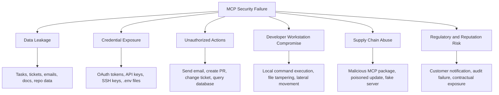

# Hacks, News, and Public Incidents

This section tracks public reports of MCP-related hacks, breaches, vulnerabilities, research demonstrations, and security incidents. It intentionally separates **confirmed public incidents** from **vulnerability disclosures**, **controlled research demos**, and **theoretical attack scenarios** so readers do not confuse lab work with real-world compromise.

> Working rule: if there is no public evidence of real-world exploitation or customer impact, list it as a disclosure, research demo, or news item — not as a breach.

---

## Classification Guide

Use these labels consistently across the project:

| Label                             | Meaning                                                                                                      | Example                                                                        |
| --------------------------------- | ------------------------------------------------------------------------------------------------------------ | ------------------------------------------------------------------------------ |
| `Confirmed public incident`       | A real service, package, or deployment was affected; customer/user impact was possible or observed.          | Asana MCP data exposure bug; malicious `postmark-mcp` npm package.             |
| `Public vulnerability disclosure` | CVE, GHSA, vendor advisory, researcher advisory, or coordinated disclosure. Exploitation may be unconfirmed. | MCP Inspector RCE; `mcp-remote` OS command injection.                          |
| `Research demo / PoC`             | Controlled attack demonstration, lab, paper, or proof-of-concept.                                            | Tool poisoning demo; WhatsApp MCP exfiltration demo.                           |
| `News coverage`                   | Media article summarizing an incident, disclosure, or ecosystem risk.                                        | The Register, BleepingComputer, The Hacker News, Dark Reading.                 |
| `Theoretical / emerging scenario` | Plausible attack pattern without a public exploit or incident.                                               | Cross-server privilege confusion, toxic tool chaining, agentic identity abuse. |

### Suggested severity lens

| Impact area                      | Questions to ask                                                                                                          |
| -------------------------------- | ------------------------------------------------------------------------------------------------------------------------- |
| Data exposure                    | Did the MCP server expose documents, messages, repo content, tickets, tasks, emails, secrets, or database rows?           |
| Credential exposure              | Were API keys, OAuth tokens, session IDs, SSH keys, cloud credentials, or `.env` files accessible?                        |
| Developer workstation compromise | Could the MCP client/server run code locally, read filesystem content, or alter repositories?                             |
| Unauthorized action              | Could an attacker cause the agent to send emails, create PRs, modify tickets, execute commands, or query private systems? |
| Supply chain compromise          | Was a package, registry entry, server template, SDK, dependency, or update channel abused?                                |
| Multi-tenant failure             | Could one tenant access another tenant’s data through an MCP integration?                                                 |
| Auditability gap                 | Were tool calls, prompts, approvals, outputs, identities, and data sources logged well enough for investigation?          |

---

## Public MCP Security Incidents

This subsection tracks real-world MCP-related incidents where there is public reporting of customer impact, malicious packages, or deployed-system exposure. Keep this list conservative: do not add pure research demos here unless there was real-world deployment impact.

### Incident table

| Incident                             | Status                                                      |                                                                                                Date / timeline | Affected technology                                                                                   | Impact                                                                                                                                                                 | Root cause / trigger                                                                                                    | Remediation                                                                                                                                                                  | Lessons learned                                                                                                                                                      | Public references                                                                                                                                                                                                                                                                                                                                                                                                                                                                                                                                                                                                                                                                                                                                                                 |
| ------------------------------------ | ----------------------------------------------------------- | -------------------------------------------------------------------------------------------------------------: | ----------------------------------------------------------------------------------------------------- | ---------------------------------------------------------------------------------------------------------------------------------------------------------------------- | ----------------------------------------------------------------------------------------------------------------------- | ---------------------------------------------------------------------------------------------------------------------------------------------------------------------------- | -------------------------------------------------------------------------------------------------------------------------------------------------------------------- | --------------------------------------------------------------------------------------------------------------------------------------------------------------------------------------------------------------------------------------------------------------------------------------------------------------------------------------------------------------------------------------------------------------------------------------------------------------------------------------------------------------------------------------------------------------------------------------------------------------------------------------------------------------------------------------------------------------------------------------------------------------------------------- |
| Asana MCP server data exposure bug   | Confirmed public incident; not reported as an external hack | Identified June 4, 2025; MCP feature offline roughly June 5–17, 2025; customer notices around June 16–18, 2025 | Asana experimental MCP server                                                                         | Potential cross-organization exposure of task, project, team, comment, discussion, and file data accessible within MCP-user permissions                                | Logic flaw / incomplete tenant isolation in MCP integration                                                             | Took MCP server offline, resolved code issue, reset connections, required manual reconnection, notified potentially affected customers, provided logs/metadata request path  | Tenant isolation must be explicitly tested for AI integrations. MCP access should be scoped per user and per tenant, not treated as a generic connector.             | [https://www.upguard.com/blog/asana-discloses-data-exposure-bug-in-mcp-server](https://www.upguard.com/blog/asana-discloses-data-exposure-bug-in-mcp-server) ; [https://www.bleepingcomputer.com/news/security/asana-warns-mcp-ai-feature-exposed-customer-data-to-other-orgs/](https://www.bleepingcomputer.com/news/security/asana-warns-mcp-ai-feature-exposed-customer-data-to-other-orgs/) ; [https://www.theregister.com/2025/06/18/asana_mcp_server_bug/](https://www.theregister.com/2025/06/18/asana_mcp_server_bug/) ; [https://www.sans.org/newsletters/newsbites/xxvii-47](https://www.sans.org/newsletters/newsbites/xxvii-47)                                                                                                                                       |
| Malicious `postmark-mcp` npm package | Confirmed malicious MCP package in the wild                 |                       Package uploaded September 2025; malicious version reported around September 25–29, 2025 | Unofficial npm package `postmark-mcp` masquerading as / copying legitimate Postmark MCP functionality | Secretly BCC’d outbound emails to an attacker-controlled address; risk included transactional emails, password resets, invoices, alerts, and sensitive business emails | Supply-chain / rug-pull pattern: legitimate-looking MCP server package gained trust, then introduced malicious behavior | Remove package, rotate Postmark/API credentials, review outbound email logs and BCC fields, inspect npm lockfiles, pin trusted packages, prefer official source repositories | MCP servers are executable supply chain components. “It works” is not a security review. Treat MCP server installs like browser extensions with backend credentials. | [https://snyk.io/blog/malicious-mcp-server-on-npm-postmark-mcp-harvests-emails/](https://snyk.io/blog/malicious-mcp-server-on-npm-postmark-mcp-harvests-emails/) ; [https://thehackernews.com/2025/09/first-malicious-mcp-server-found.html](https://thehackernews.com/2025/09/first-malicious-mcp-server-found.html) ; [https://www.darkreading.com/application-security/malicious-mcp-server-exfiltrates-secrets-bcc](https://www.darkreading.com/application-security/malicious-mcp-server-exfiltrates-secrets-bcc) ; [https://semgrep.dev/blog/2025/so-the-first-malicious-mcp-server-has-been-found-on-npm-what-does-this-mean-for-mcp-security](https://semgrep.dev/blog/2025/so-the-first-malicious-mcp-server-has-been-found-on-npm-what-does-this-mean-for-mcp-security) |

### Incident write-up format

Use this format for every future incident:

```markdown
### [Incident name]

- **Status:** Confirmed incident / suspected incident / disclosure only / research demo
- **Affected organization/project:**
- **Incident date:**
- **Disclosure date:**
- **Affected MCP component:** Client / host / server / SDK / gateway / registry / package / tool
- **Impact:** Data leakage / RCE / token exposure / unauthorized actions / supply chain compromise / other
- **Root cause:** Authorization bug / prompt injection / tool poisoning / command injection / unsafe defaults / dependency compromise / tenant isolation failure
- **Evidence level:** Vendor statement / CVE / GHSA / researcher advisory / media report / unverified social post
- **Exploitation in the wild:** Confirmed / suspected / not reported / unknown
- **Remediation:**
- **Detection ideas:**
- **Lessons learned:**
- **References:**
```

---

## Public Vulnerability Disclosures

This subsection tracks public MCP-related vulnerability disclosures that may or may not have CVEs. These are not automatically “incidents.” Most are best treated as security advisories unless exploitation or affected-customer impact is confirmed.

### High-signal disclosures to track

| Vulnerability / advisory                                   |                                           Disclosure date | Affected project                                              | Type                                                                                   | Impact                                                                                                                                                | Fix status                                                                                                      | Researcher / source                                                             | Reference links                                                                                                                                                                                                                                                                                                                                                                                                                                                                                                                                                                                                                                                                               |
| ---------------------------------------------------------- | --------------------------------------------------------: | ------------------------------------------------------------- | -------------------------------------------------------------------------------------- | ----------------------------------------------------------------------------------------------------------------------------------------------------- | --------------------------------------------------------------------------------------------------------------- | ------------------------------------------------------------------------------- | --------------------------------------------------------------------------------------------------------------------------------------------------------------------------------------------------------------------------------------------------------------------------------------------------------------------------------------------------------------------------------------------------------------------------------------------------------------------------------------------------------------------------------------------------------------------------------------------------------------------------------------------------------------------------------------------- |
| CVE-2025-49596 / GHSA-7f8r-222p-6f5g                       |                                                 June 2025 | MCP Inspector                                                 | Missing auth between inspector client and proxy; RCE                                   | Unauthenticated requests could launch MCP commands over stdio; developer workstation compromise risk                                                  | Patched in MCP Inspector `0.14.1`                                                                               | Tenable; also covered by Oligo and others                                       | [https://nvd.nist.gov/vuln/detail/CVE-2025-49596](https://nvd.nist.gov/vuln/detail/CVE-2025-49596) ; [https://github.com/advisories/GHSA-7f8r-222p-6f5g](https://github.com/advisories/GHSA-7f8r-222p-6f5g) ; [https://www.tenable.com/blog/how-tenable-research-discovered-a-critical-remote-code-execution-vulnerability-on-anthropic](https://www.tenable.com/blog/how-tenable-research-discovered-a-critical-remote-code-execution-vulnerability-on-anthropic) ; [https://www.oligo.security/blog/critical-rce-vulnerability-in-anthropic-mcp-inspector-cve-2025-49596](https://www.oligo.security/blog/critical-rce-vulnerability-in-anthropic-mcp-inspector-cve-2025-49596)             |
| CVE-2025-6514 / GHSA-6xpm-ggf7-wc3p                        |                                                 July 2025 | `mcp-remote`                                                  | OS command injection via untrusted MCP server auth metadata                            | Malicious server could trigger arbitrary OS command execution on the client machine using crafted `authorization_endpoint`                            | Patched in `mcp-remote` `0.1.16`                                                                                | JFrog Security Research                                                         | [https://jfrog.com/blog/2025-6514-critical-mcp-remote-rce-vulnerability/](https://jfrog.com/blog/2025-6514-critical-mcp-remote-rce-vulnerability/) ; [https://nvd.nist.gov/vuln/detail/CVE-2025-6514](https://nvd.nist.gov/vuln/detail/CVE-2025-6514) ; [https://github.com/advisories/GHSA-6xpm-ggf7-wc3p](https://github.com/advisories/GHSA-6xpm-ggf7-wc3p)                                                                                                                                                                                                                                                                                                                                |
| CVE-2025-34072 / GHSA-gmx5-crwh-6vxg                       |                                                 July 2025 | Deprecated Anthropic Slack MCP Server                         | Data exfiltration via automatic Slack link unfurling                                   | Untrusted data could cause generated Slack messages to include attacker-controlled URLs embedding sensitive data; Slack preview bots could fetch them | Component deprecated; discontinue use or isolate heavily                                                        | Embrace The Red / wunderwuzzi; VulnCheck; NVD                                   | [https://nvd.nist.gov/vuln/detail/CVE-2025-34072](https://nvd.nist.gov/vuln/detail/CVE-2025-34072) ; [https://github.com/advisories/GHSA-gmx5-crwh-6vxg](https://github.com/advisories/GHSA-gmx5-crwh-6vxg) ; [https://www.vulncheck.com/advisories/anthropic-slack-mcp-server-data-exfiltration](https://www.vulncheck.com/advisories/anthropic-slack-mcp-server-data-exfiltration) ; [https://embracethered.com/blog/posts/2025/security-advisory-anthropic-slack-mcp-server-data-leakage/](https://embracethered.com/blog/posts/2025/security-advisory-anthropic-slack-mcp-server-data-leakage/)                                                                                           |
| CVE-2025-68143, CVE-2025-68144, CVE-2025-68145             | Disclosed publicly December 2025 (advisories published 2025-12-17); media coverage January 2026; reported to the vendor earlier in 2025 | Anthropic / reference `mcp-server-git`                        | Unrestricted `git_init`, argument injection, path validation bypass                    | Prompt-injection-triggerable file tampering, arbitrary file access, and possible RCE when chained with filesystem tooling                             | Fixed in `mcp-server-git` `2025.12.18`                                                                          | Cyata; media coverage by SecurityWeek, The Register/TechRadar                   | [https://nvd.nist.gov/vuln/detail/CVE-2025-68143](https://nvd.nist.gov/vuln/detail/CVE-2025-68143) ; [https://github.com/advisories/GHSA-9xwc-hfwc-8w59](https://github.com/advisories/GHSA-9xwc-hfwc-8w59) ; [https://www.securityweek.com/anthropic-mcp-server-flaws-lead-to-code-execution-data-exposure/](https://www.securityweek.com/anthropic-mcp-server-flaws-lead-to-code-execution-data-exposure/) ; [https://www.techradar.com/pro/security/anthropics-official-git-mcp-server-had-some-worrying-security-flaws-this-is-what-happened-next](https://www.techradar.com/pro/security/anthropics-official-git-mcp-server-had-some-worrying-security-flaws-this-is-what-happened-next) |
| CVE-2025-6515 / GHSA-rvw9-mm8q-456q                        |                                              October 2025 | `oatpp-mcp`                                                   | Weak/non-cryptographic MCP SSE session IDs                                             | Network attacker with access to server could guess or hijack MCP sessions and return malicious responses                                              | Fix status should be verified in upstream project before use                                                    | JFrog Security Research                                                         | [https://nvd.nist.gov/vuln/detail/CVE-2025-6515](https://nvd.nist.gov/vuln/detail/CVE-2025-6515) ; [https://github.com/advisories/GHSA-rvw9-mm8q-456q](https://github.com/advisories/GHSA-rvw9-mm8q-456q) ; [https://jfrog.com/blog/mcp-prompt-hijacking-vulnerability/](https://jfrog.com/blog/mcp-prompt-hijacking-vulnerability/)                                                                                                                                                                                                                                                                                                                                                          |
| GHSA-w48q-cv73-mx4w / CVE-2025-66414                       |                                             December 2025 | MCP TypeScript SDK                                            | DNS rebinding protection not enabled by default for local unauthenticated HTTP servers | Malicious websites could bypass browser same-origin protections and invoke tools/resources on local MCP servers in limited conditions                 | Patched in `@modelcontextprotocol/sdk` `1.24.0`; custom Express setups should add host-header validation        | GitHub Advisory Database                                                        | [https://github.com/advisories/GHSA-w48q-cv73-mx4w](https://github.com/advisories/GHSA-w48q-cv73-mx4w)                                                                                                                                                                                                                                                                                                                                                                                                                                                                                                                                                                                        |
| CVE-2025-52573 / GHSA-6f6r-m9pv-67jw                       |                                                 June 2025 | `ios-simulator-mcp`                                           | Command injection via `exec` API                                                       | Prompt-injection or malicious arguments could alter simulator command execution and run unintended shell commands                                     | Patched in `1.3.3`                                                                                              | Liran Tal                                                                       | [https://github.com/advisories/GHSA-6f6r-m9pv-67jw](https://github.com/advisories/GHSA-6f6r-m9pv-67jw)                                                                                                                                                                                                                                                                                                                                                                                                                                                                                                                                                                                        |
| CVE-2025-54994 / GHSA-3ch2-jxxc-v4xf                       |                                            September 2025 | `@akoskm/create-mcp-server-stdio`                             | Command injection via `exec` API                                                       | Tool input could be interpreted by shell, causing command execution on host                                                                           | Patched in `0.0.13`                                                                                             | Liran Tal                                                                       | [https://github.com/advisories/GHSA-3ch2-jxxc-v4xf](https://github.com/advisories/GHSA-3ch2-jxxc-v4xf)                                                                                                                                                                                                                                                                                                                                                                                                                                                                                                                                                                                        |
| GHSA-54j7-grvr-9xwg                                        |                                            September 2025 | `adb-mcp`                                                     | Command injection in Android Debug Bridge MCP tooling                                  | Unsafe shell construction around ADB command execution                                                                                                | No patched version listed in advisory at time of publication                                                    | GitHub Advisory Database                                                        | [https://github.com/advisories/GHSA-54j7-grvr-9xwg](https://github.com/advisories/GHSA-54j7-grvr-9xwg)                                                                                                                                                                                                                                                                                                                                                                                                                                                                                                                                                                                        |
| GHSA-wvxp-jp4w-w8wg / CVE-2025-66404                       |                                             December 2025 | `mcp-server-kubernetes`                                       | Command injection via string commands to pod exec tooling                              | Direct command injection or indirect prompt injection through pod logs could trigger shell interpretation                                             | Track upstream patched versions and restrict tool access                                                        | GitHub Advisory Database                                                        | [https://github.com/advisories/GHSA-wvxp-jp4w-w8wg](https://github.com/advisories/GHSA-wvxp-jp4w-w8wg)                                                                                                                                                                                                                                                                                                                                                                                                                                                                                                                                                                                        |
| GHSA-3gcm-f6qx-ff7p                                        |                                            September 2025 | Flowise `CustomMCP` node                                      | Unsafe parsing/execution of user-provided MCP configuration                            | Remote code execution through unsafe JavaScript evaluation in MCP server config parsing                                                               | Track patched Flowise versions and disable unsafe custom MCP config                                             | GitHub Advisory Database                                                        | [https://github.com/advisories/GHSA-3gcm-f6qx-ff7p](https://github.com/advisories/GHSA-3gcm-f6qx-ff7p)                                                                                                                                                                                                                                                                                                                                                                                                                                                                                                                                                                                        |
| CVE-2026-6599                                              |                                                April 2026 | Langflow MCP Projects API                                     | Injection in MCP configuration API handling                                            | Remote manipulation of `X-Forwarded-For` argument could lead to injection                                                                             | Verify affected versions and fixed release before deployment                                                    | NVD                                                                             | [https://nvd.nist.gov/vuln/detail/CVE-2026-6599](https://nvd.nist.gov/vuln/detail/CVE-2026-6599)                                                                                                                                                                                                                                                                                                                                                                                                                                                                                                                                                                                              |
| OpenAI Codex CLI MCP config advisory / GHSA-xrxf-jgv3-qmrm |                                                April 2026 | OpenAI Codex CLI <= `0.23.0`                                  | Code execution through malicious project-local MCP configuration files                 | Running `codex` inside a malicious repository could load project-local `.env` / `.codex/config.toml` and execute configured commands                  | Review current vendor guidance; use trusted-project controls; do not run agentic CLIs in untrusted repositories | GitHub Advisory Database; OpenAI Codex docs for trusted project config behavior | [https://github.com/advisories/GHSA-xrxf-jgv3-qmrm](https://github.com/advisories/GHSA-xrxf-jgv3-qmrm) ; [https://developers.openai.com/codex/config-basic](https://developers.openai.com/codex/config-basic) ; [https://developers.openai.com/codex/config-advanced](https://developers.openai.com/codex/config-advanced)                                                                                                                                                                                                                                                                                                                                                                    |
| OX Security MCP STDIO architectural RCE research           |                                                April 2026 | MCP SDK ecosystem and MCP-based projects using STDIO patterns | Systemic STDIO process execution / command construction risk                           | Reported impact across MCP SDKs and downstream projects; multiple CVEs reported by researchers                                                        | Mixed: some downstream fixes, protocol-level debate ongoing                                                     | OX Security Research; media coverage                                            | [https://www.ox.security/blog/the-mother-of-all-ai-supply-chains-critical-systemic-vulnerability-at-the-core-of-the-mcp/](https://www.ox.security/blog/the-mother-of-all-ai-supply-chains-critical-systemic-vulnerability-at-the-core-of-the-mcp/) ; [https://thehackernews.com/2026/04/anthropic-mcp-design-vulnerability.html](https://thehackernews.com/2026/04/anthropic-mcp-design-vulnerability.html)                                                                                                                                                                                                                                                                                   |

### Disclosure tracking fields

For each disclosure, store:

* **CVE / GHSA / advisory ID**
* **Affected project and package ecosystem**: npm, PyPI, Go, Docker, browser extension, IDE plugin, etc.
* **Affected versions**
* **Patched versions**
* **Exploitability**: local, remote, prompt-injection-assisted, malicious-server-assisted, user-interaction-required
* **Known exploitation**: confirmed, suspected, none reported, unknown
* **MCP layer**: host, client, server, SDK, gateway, registry, tool, transport
* **Mapped MCP risk**: tool poisoning, command injection, data exfiltration, token/session abuse, supply chain, unsafe defaults, authorization failure
* **Recommended action**: upgrade, remove, disable, rotate credentials, review logs, add policy controls

---

## Research Demos and Proofs of Concept

This subsection tracks controlled demos, attack writeups, and papers. These are valuable for learning and defense, but they should be clearly labeled so readers do not assume every demo represents a real breach.

| Research / demo                                   |                     Date | Type                             | What it showed                                                                                                                                   | Safety label                                       | Why it matters                                                                                                              | References                                                                                                                                                                                     |
| ------------------------------------------------- | -----------------------: | -------------------------------- | ------------------------------------------------------------------------------------------------------------------------------------------------ | -------------------------------------------------- | --------------------------------------------------------------------------------------------------------------------------- | ---------------------------------------------------------------------------------------------------------------------------------------------------------------------------------------------- |
| MCP Tool Poisoning disclosure                     |               April 2025 | Research disclosure              | Malicious instructions embedded in tool descriptions can influence the model’s tool selection and behavior                                       | Conceptual + PoC; defensive use recommended        | Tool metadata is part of the model context. Treat tool descriptions as untrusted input, not documentation.                  | [https://invariantlabs.ai/blog/mcp-security-notification-tool-poisoning-attacks](https://invariantlabs.ai/blog/mcp-security-notification-tool-poisoning-attacks)                               |
| WhatsApp MCP exfiltration demo                    |               April 2025 | Controlled research demo         | An untrusted MCP server could influence an agent connected to a trusted WhatsApp MCP server and exfiltrate chat history                          | Controlled PoC                                     | Demonstrates cross-server trust failure: one malicious server can abuse another trusted server through the agent.           | [https://invariantlabs.ai/blog/whatsapp-mcp-exploited](https://invariantlabs.ai/blog/whatsapp-mcp-exploited)                                                                                   |
| GitHub MCP prompt-injection data heist            | May/August 2025 coverage | Research demo / attack scenario  | Malicious GitHub issue text can prompt-inject an agent into accessing private repo data and leaking it through public channels                   | Controlled PoC; do not reproduce against real orgs | Shows how untrusted repo content can become instructions, and why broad GitHub tokens are dangerous.                        | [https://www.docker.com/blog/mcp-horror-stories-github-prompt-injection/](https://www.docker.com/blog/mcp-horror-stories-github-prompt-injection/)                                             |
| “MCP: Untrusted Servers and Confused Clients”     |                 May 2025 | Research writeup / exploit chain | Untrusted MCP servers can manipulate confused clients and abuse tool permissions                                                                 | Educational PoC                                    | Frames MCP as a confused-deputy problem: the model/client may execute attacker-supplied intent with user-granted authority. | [https://embracethered.com/blog/posts/2025/model-context-protocol-security-risks-and-exploits/](https://embracethered.com/blog/posts/2025/model-context-protocol-security-risks-and-exploits/) |
| Cursor MCPoison research                          |              August 2025 | IDE / developer workflow PoC     | Workspace-linked configuration and AI IDE behavior can create attack paths when developers open untrusted repositories                           | Controlled PoC                                     | Developer workstations are high-value MCP targets because they hold source code, tokens, terminals, and local config.       | [https://research.checkpoint.com/2025/cursor-vulnerability-mcpoison/](https://research.checkpoint.com/2025/cursor-vulnerability-mcpoison/)                                                     |
| MCP Safety Audit paper / MCPSafetyScanner         |               April 2025 | Academic / tooling paper         | MCP-enabled LLM workflows could be coerced into malicious code execution, remote access, and credential theft; authors proposed an auditing tool | Academic PoC and defensive scanner                 | Provides a structured way to test arbitrary MCP servers for risky behavior.                                                 | [https://arxiv.org/abs/2504.03767](https://arxiv.org/abs/2504.03767)                                                                                                                           |
| Trivial Trojans                                   |                July 2025 | Academic paper                   | A minimal malicious MCP server disguised as benign functionality can discover and exploit legitimate tools to exfiltrate sensitive data          | Academic PoC                                       | Shows that MCP attacks may require low sophistication: the dangerous part is cross-tool trust, not advanced malware.        | [https://arxiv.org/abs/2507.19880](https://arxiv.org/abs/2507.19880)                                                                                                                           |
| Mind Your Server / MCP-UPD                        |           September 2025 | Academic paper                   | Parasitic toolchain attacks can use external data sources to steer MCP toolchains toward privacy disclosure                                      | Academic study                                     | Reinforces the need for context-tool isolation, least privilege, and provenance-aware tool calls.                           | [https://arxiv.org/abs/2509.06572](https://arxiv.org/abs/2509.06572)                                                                                                                           |
| MCP threat modeling and client defense evaluation |               March 2026 | Academic / empirical evaluation  | Tool poisoning was evaluated across multiple MCP clients; validation and parameter visibility gaps were highlighted                              | Academic evaluation                                | Useful for comparing client-side defenses and building test cases for enterprise MCP gateways.                              | [https://arxiv.org/abs/2603.22489](https://arxiv.org/abs/2603.22489)                                                                                                                           |

### PoC safety tags

Use these tags when linking demos:

| Tag                     | Meaning                                                                                                   |
| ----------------------- | --------------------------------------------------------------------------------------------------------- |
| `safe-summary`          | Blog/paper explains the issue without operational exploit steps.                                          |
| `defensive-demo`        | Demo is designed for authorized labs or training.                                                         |
| `partial-poc`           | Shows key idea but omits weaponized details.                                                              |
| `weaponized-poc`        | Includes exploit code or steps that could directly harm real systems. Link with caution and add warnings. |
| `do-not-run-production` | Code should only be used in isolated lab environments.                                                    |

Recommended warning banner for exploit-heavy links:

```markdown
> ⚠️ Educational use only: Review and run this proof-of-concept only in an isolated lab you own or are explicitly authorized to test. Do not run against production MCP clients, SaaS tenants, developer workstations, or third-party systems.
```

---

## News Coverage

This subsection tracks media coverage of MCP security incidents, disclosures, and ecosystem risk. Prefer primary sources first, then add media coverage for context, impact, and timeline.

| Article                                                                                    | Publisher        |               Date | Topic                                                      | Why it matters                                                                                                | Link                                                                                                                                                                                                                                                                               |
| ------------------------------------------------------------------------------------------ | ---------------- | -----------------: | ---------------------------------------------------------- | ------------------------------------------------------------------------------------------------------------- | ---------------------------------------------------------------------------------------------------------------------------------------------------------------------------------------------------------------------------------------------------------------------------------- |
| Asana warns MCP AI feature exposed customer data to other orgs                             | BleepingComputer |      June 18, 2025 | Asana MCP data exposure                                    | Clear incident summary; emphasizes logic flaw and potential cross-tenant exposure.                            | [https://www.bleepingcomputer.com/news/security/asana-warns-mcp-ai-feature-exposed-customer-data-to-other-orgs/](https://www.bleepingcomputer.com/news/security/asana-warns-mcp-ai-feature-exposed-customer-data-to-other-orgs/)                                                   |
| Asana MCP server back online after plugging a data-leak hole                               | The Register     |      June 18, 2025 | Asana MCP data exposure                                    | Notes downtime, reset connections, manual reconnection, and the experimental nature of the feature.           | [https://www.theregister.com/2025/06/18/asana_mcp_server_bug/](https://www.theregister.com/2025/06/18/asana_mcp_server_bug/)                                                                                                                                                       |
| Experimental MCP Server Exposed Asana Data                                                 | SANS NewsBites   |      June 24, 2025 | Asana MCP data exposure                                    | Useful CISO-facing commentary on authorization sprawl and AI-integrated access control.                       | [https://www.sans.org/newsletters/newsbites/xxvii-47](https://www.sans.org/newsletters/newsbites/xxvii-47)                                                                                                                                                                         |
| Critical Vulnerability in Anthropic’s MCP Exposes Developer Machines to Remote Exploits    | The Hacker News  |       July 1, 2025 | MCP Inspector RCE                                          | Mainstream coverage of a critical developer-tool vulnerability.                                               | [https://thehackernews.com/2025/07/critical-vulnerability-in-anthropics.html](https://thehackernews.com/2025/07/critical-vulnerability-in-anthropics.html)                                                                                                                         |
| Sneaky, Malicious MCP Server Exfiltrates Secrets via BCC                                   | Dark Reading     | September 29, 2025 | Malicious `postmark-mcp` package                           | Explains why MCP packages are a new software supply-chain attack surface.                                     | [https://www.darkreading.com/application-security/malicious-mcp-server-exfiltrates-secrets-bcc](https://www.darkreading.com/application-security/malicious-mcp-server-exfiltrates-secrets-bcc)                                                                                     |
| First Malicious MCP Server Found Stealing Emails in Rogue Postmark-MCP Package                | The Hacker News  | September 29, 2025 | Malicious `postmark-mcp` package                           | Useful for tracking first-known malicious MCP server reporting and ecosystem response.                        | [https://thehackernews.com/2025/09/first-malicious-mcp-server-found.html](https://thehackernews.com/2025/09/first-malicious-mcp-server-found.html)                                                                                                                                 |
| Anthropic MCP Server Flaws Lead to Code Execution, Data Exposure                           | SecurityWeek     |   January 21, 2026 | Anthropic Git MCP server vulnerabilities                   | Shows how prompt injection can weaponize conventional argument/path bugs in MCP tools.                        | [https://www.securityweek.com/anthropic-mcp-server-flaws-lead-to-code-execution-data-exposure/](https://www.securityweek.com/anthropic-mcp-server-flaws-lead-to-code-execution-data-exposure/)                                                                                     |
| Anthropic’s official Git MCP server had some worrying security flaws                       | TechRadar        |       January 2026 | Anthropic Git MCP server vulnerabilities                   | Useful business-readable coverage of chained MCP tool risks.                                                  | [https://www.techradar.com/pro/security/anthropics-official-git-mcp-server-had-some-worrying-security-flaws-this-is-what-happened-next](https://www.techradar.com/pro/security/anthropics-official-git-mcp-server-had-some-worrying-security-flaws-this-is-what-happened-next)     |
| Anthropic MCP Design Vulnerability Enables RCE, Threatening AI Supply Chain                | The Hacker News  |     April 20, 2026 | OX Security MCP STDIO architectural vulnerability research | Tracks ecosystem-level debate around protocol design, SDK behavior, and downstream CVEs.                      | [https://thehackernews.com/2026/04/anthropic-mcp-design-vulnerability.html](https://thehackernews.com/2026/04/anthropic-mcp-design-vulnerability.html)                                                                                                                             |
| Anthropic’s Model Context Protocol includes a critical remote code execution vulnerability | Tom’s Hardware   |         April 2026 | OX Security MCP STDIO architectural vulnerability research | Useful non-specialist summary of impact claims such as server count, SDK coverage, and supply-chain concerns. | [https://www.tomshardware.com/tech-industry/artificial-intelligence/anthropics-model-context-protocol-has-critical-security-flaw-exposed](https://www.tomshardware.com/tech-industry/artificial-intelligence/anthropics-model-context-protocol-has-critical-security-flaw-exposed) |

### News inclusion checklist

Include a news item only when it adds at least one of the following:

* confirms dates or timeline;
* adds affected customer/user impact;
* quotes a vendor, researcher, or affected party;
* explains remediation or fixed versions;
* helps non-expert readers understand business risk;
* links to primary advisories, CVEs, or vendor statements.

Avoid adding low-quality reposts that repeat the same facts without original reporting.

---

## Business and Security Impact

MCP incidents matter because MCP turns AI assistants into action-taking software connected to files, SaaS systems, source code, cloud consoles, databases, and developer machines. A compromised MCP workflow is not just “bad chatbot output”; it can become unauthorized access through legitimate tools.

### Impact map



### Business impact categories

| Impact                           | What it looks like in MCP                                                                                   | Example signal                                                                            | Business consequence                                                                |
| -------------------------------- | ----------------------------------------------------------------------------------------------------------- | ----------------------------------------------------------------------------------------- | ----------------------------------------------------------------------------------- |
| Data leakage                     | Agent reads or summarizes data from the wrong tenant, repo, folder, ticket, Slack channel, or email account | Unexpected customer/project names in AI output; tool calls accessing unrelated object IDs | Breach notification analysis, customer trust loss, privacy review, legal escalation |
| Credential exposure              | MCP tool reads local secrets or returns tokens to the model context                                         | Access to `.env`, `~/.aws/credentials`, GitHub tokens, OAuth refresh tokens               | Cloud compromise, SaaS account takeover, forced rotation, incident response cost    |
| Unauthorized actions             | Prompt injection causes legitimate tools to perform attacker-intended actions                               | Unexpected PRs, emails, ticket changes, database queries, CI jobs                         | Fraud, workflow disruption, destructive changes, audit failures                     |
| Developer workstation compromise | MCP client/server runs commands or modifies files on a developer machine                                    | Shell execution from MCP tool, suspicious child processes, modified dotfiles              | Source-code theft, persistence, internal network pivoting                           |
| Supply-chain compromise          | Malicious MCP server package or registry entry is installed                                                 | New package versions, lookalike names, suspicious outbound traffic                        | Enterprise-wide exposure through trusted developer workflows                        |
| Regulatory risk                  | Sensitive personal/customer data flows through AI tools without control                                     | Missing consent records, no audit logs, cross-border data movement                        | GDPR/DPDP/HIPAA/SOC 2/ISO audit findings, penalties, mandatory reporting            |
| Reputational damage              | Public disclosure of unsafe AI integration                                                                  | Press coverage, customer advisories, forced shutdown of AI feature                        | Loss of confidence in AI roadmap and security governance                            |

### Incident response questions for MCP incidents

When investigating an MCP-related event, ask:

1. **Which MCP client/host initiated the action?**

   * Claude Desktop, Cursor, VS Code, Codex, custom agent, gateway, CI job, etc.

2. **Which MCP server and tool were invoked?**

   * Server name, package, version, source registry, hash, command path, tool name.

3. **What context influenced the model?**

   * User prompt, webpage, README, issue, ticket, Slack message, email, document, tool description, tool output.

4. **What identity was used?**

   * Human user token, service account, OAuth app, personal access token, shared API key, local environment variable.

5. **What data was accessed or returned?**

   * Files, records, messages, repositories, database rows, secrets, customer objects.

6. **Was an approval shown and accepted?**

   * Approval prompt text, risk label, user decision, bypasses, auto-approval rules.

7. **What left the environment?**

   * HTTP requests, Slack unfurls, emails, public PRs, DNS queries, pasted output, logs.

8. **Can the action be replayed safely in a lab?**

   * Preserve prompts, tool logs, server versions, package lockfiles, network traces, and policy decisions.

### Common root causes

| Root cause                  | Description                                                                        | Preventive control                                                                   |
| --------------------------- | ---------------------------------------------------------------------------------- | ------------------------------------------------------------------------------------ |
| Over-broad permissions      | MCP server receives more access than the task requires                             | Least privilege, per-tool scopes, per-resource OAuth, just-in-time grants            |
| Tool poisoning              | Malicious instructions hidden in tool descriptions or metadata                     | Tool registry review, signed metadata, scanner checks, client-side warnings          |
| Indirect prompt injection   | Malicious instructions hidden in files, issues, webpages, emails, tickets, or logs | Context isolation, instruction hierarchy, prompt-injection filters, approval gates   |
| Unsafe shell execution      | Tool uses `exec` or shell interpolation with model/user-controlled input           | Use `execFile`/argument arrays, schema validation, deny shell metacharacters         |
| Missing tenant isolation    | MCP integration does not enforce tenant boundaries correctly                       | Tenant-aware authorization tests, object-level access checks, chaos testing          |
| Weak session/token handling | Guessable session IDs, token passthrough, wrong token audience, shared secrets     | OAuth 2.1 best practices, audience validation, token exchange, no token passthrough  |
| Unsafe local configuration  | Project-local config or workspace files auto-load tools/commands                   | Workspace trust, signed configs, user approval, disable auto-load in untrusted repos |
| Poor logging                | Tool calls and model context are not captured                                      | Structured MCP audit logs, prompt/tool/output retention, SIEM integration            |

### Practical executive summary

MCP incidents collapse the boundary between **AI behavior risk**, **application security**, **identity**, and **software supply chain**. A single unsafe MCP server can become a confused deputy with access to email, source code, cloud credentials, and business systems. The defensive baseline is: inventory every MCP server, verify provenance, enforce least privilege, log every tool call, isolate untrusted context, and require human approval for sensitive or destructive actions.

### One-line takeaway

> MCP makes AI useful by giving it tools; MCP security makes sure those tools do not become the attacker’s hands.

---

## Maintainer Notes

* Review this section monthly because MCP disclosures are moving quickly.
* Prefer primary sources: vendor advisories, NVD, GitHub Advisory Database, researcher writeups, official specs.
* Mark media-only claims as `reported` until confirmed by a primary source.
* Do not publish exploit payloads directly in this list unless the resource is intentionally a lab and clearly marked.
* Keep “confirmed incidents” separate from “research demos.” This protects the credibility of the project.
